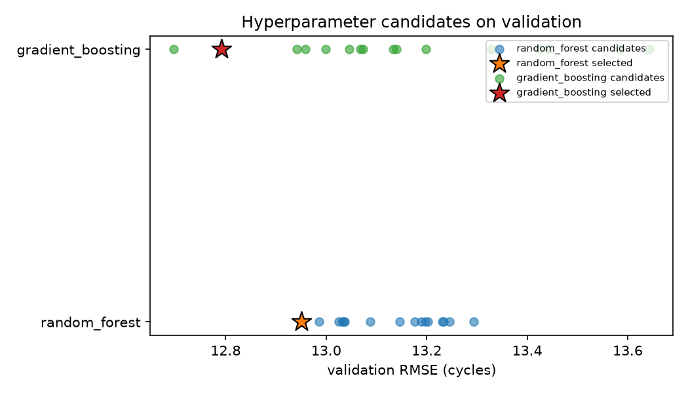
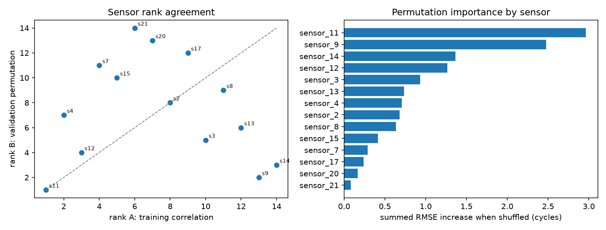

# Session 3: classical ML and sensor intelligence

Config `configs/session3_classical_ml.yaml`, seed 42, target `capped`. Hyperparameters were selected on validation only; the test set was used once, for the selected models. Timing values are in the results table / MLflow, not here.

## Features

14 sensors x 6 temporal features (last, mean, std, min, max, slope) = 84 columns, sensor-major order (`<sensor>__<feature>`). Slope = OLS slope over cycle index 0..29, std = population std.

## random_forest: validation search (16 candidates)

| candidate | params | rmse | mae | r2 | nasa | nodes | selected |
|---|---|---|---|---|---|---|---|
| 0 | n_estimators=100, max_depth=10, min_samples_leaf=3, max_features=0.3 | 13.234 | 9.757 | 0.8978 | 14225 | 117382 |  |
| 1 | n_estimators=100, max_depth=10, min_samples_leaf=3, max_features=0.6 | 13.293 | 9.810 | 0.8969 | 14650 | 116892 |  |
| 2 | n_estimators=100, max_depth=10, min_samples_leaf=10, max_features=0.3 | 13.189 | 9.769 | 0.8985 | 13499 | 65736 |  |
| 3 | n_estimators=100, max_depth=10, min_samples_leaf=10, max_features=0.6 | 13.177 | 9.782 | 0.8987 | 14341 | 66310 |  |
| 4 | n_estimators=100, max_depth=20, min_samples_leaf=3, max_features=0.3 | 13.147 | 9.652 | 0.8992 | 13380 | 360802 |  |
| 5 | n_estimators=100, max_depth=20, min_samples_leaf=3, max_features=0.6 | 13.036 | 9.618 | 0.9009 | 13103 | 356222 |  |
| 6 | n_estimators=100, max_depth=20, min_samples_leaf=10, max_features=0.3 | 12.951 | 9.551 | 0.9022 | 12517 | 117656 | yes |
| 7 | n_estimators=100, max_depth=20, min_samples_leaf=10, max_features=0.6 | 13.088 | 9.642 | 0.9001 | 12805 | 116014 |  |
| 8 | n_estimators=300, max_depth=10, min_samples_leaf=3, max_features=0.3 | 13.245 | 9.774 | 0.8977 | 13904 | 349988 |  |
| 9 | n_estimators=300, max_depth=10, min_samples_leaf=3, max_features=0.6 | 13.197 | 9.754 | 0.8984 | 14442 | 350394 |  |
| 10 | n_estimators=300, max_depth=10, min_samples_leaf=10, max_features=0.3 | 13.202 | 9.780 | 0.8983 | 13637 | 197524 |  |
| 11 | n_estimators=300, max_depth=10, min_samples_leaf=10, max_features=0.6 | 13.232 | 9.832 | 0.8979 | 14413 | 199172 |  |
| 12 | n_estimators=300, max_depth=20, min_samples_leaf=3, max_features=0.3 | 13.037 | 9.563 | 0.9009 | 13029 | 1082806 |  |
| 13 | n_estimators=300, max_depth=20, min_samples_leaf=3, max_features=0.6 | 13.031 | 9.634 | 0.9009 | 12818 | 1066518 |  |
| 14 | n_estimators=300, max_depth=20, min_samples_leaf=10, max_features=0.3 | 12.986 | 9.585 | 0.9016 | 12615 | 353038 |  |
| 15 | n_estimators=300, max_depth=20, min_samples_leaf=10, max_features=0.6 | 13.025 | 9.636 | 0.9010 | 12924 | 347378 |  |

Rule: lowest validation rmse; candidates within 1% of the best (12.951) are equivalent (6 here); the smallest model is chosen.

## gradient_boosting: validation search (16 candidates)

| candidate | params | rmse | mae | r2 | nasa | nodes | selected |
|---|---|---|---|---|---|---|---|
| 0 | max_iter=200, learning_rate=0.03, max_depth=3, max_features=0.5 | 12.942 | 9.613 | 0.9023 | 11860 | 3000 |  |
| 1 | max_iter=200, learning_rate=0.03, max_depth=3, max_features=1.0 | 13.133 | 9.813 | 0.8994 | 12291 | 2996 |  |
| 2 | max_iter=200, learning_rate=0.03, max_depth=6, max_features=0.5 | 12.697 | 9.134 | 0.9060 | 11368 | 12200 |  |
| 3 | max_iter=200, learning_rate=0.03, max_depth=6, max_features=1.0 | 12.791 | 9.268 | 0.9046 | 11788 | 12196 | yes |
| 4 | max_iter=200, learning_rate=0.1, max_depth=3, max_features=0.5 | 13.198 | 9.625 | 0.8984 | 12030 | 2968 |  |
| 5 | max_iter=200, learning_rate=0.1, max_depth=3, max_features=1.0 | 13.329 | 9.733 | 0.8964 | 12174 | 2970 |  |
| 6 | max_iter=200, learning_rate=0.1, max_depth=6, max_features=0.5 | 13.046 | 9.302 | 0.9007 | 12487 | 12158 |  |
| 7 | max_iter=200, learning_rate=0.1, max_depth=6, max_features=1.0 | 13.423 | 9.741 | 0.8949 | 12563 | 12148 |  |
| 8 | max_iter=500, learning_rate=0.03, max_depth=3, max_features=0.5 | 12.999 | 9.446 | 0.9014 | 11874 | 7480 |  |
| 9 | max_iter=500, learning_rate=0.03, max_depth=3, max_features=1.0 | 13.140 | 9.575 | 0.8993 | 12323 | 7452 |  |
| 10 | max_iter=500, learning_rate=0.03, max_depth=6, max_features=0.5 | 12.959 | 9.271 | 0.9020 | 11810 | 30426 |  |
| 11 | max_iter=500, learning_rate=0.03, max_depth=6, max_features=1.0 | 13.073 | 9.403 | 0.9003 | 12086 | 30436 |  |
| 12 | max_iter=500, learning_rate=0.1, max_depth=3, max_features=0.5 | 13.443 | 9.870 | 0.8946 | 12348 | 7324 |  |
| 13 | max_iter=500, learning_rate=0.1, max_depth=3, max_features=1.0 | 13.643 | 9.985 | 0.8914 | 12892 | 7296 |  |
| 14 | max_iter=500, learning_rate=0.1, max_depth=6, max_features=0.5 | 13.068 | 9.344 | 0.9004 | 12387 | 30062 |  |
| 15 | max_iter=500, learning_rate=0.1, max_depth=6, max_features=1.0 | 13.585 | 9.858 | 0.8923 | 12978 | 29924 |  |

Rule: lowest validation rmse; candidates within 1% of the best (12.697) are equivalent (2 here); the smallest model is chosen.

## Selected full-sensor models

| model | eval_set | n_samples | rmse | mae | r2 | nasa_score |
|---|---|---|---|---|---|---|
| random_forest | validation | 3272 | 12.951 | 9.551 | 0.9022 | 12517.1 |
| random_forest | test | 100 | 11.591 | 8.788 | 0.9163 | 208.7 |
| gradient_boosting | validation | 3272 | 12.791 | 9.268 | 0.9046 | 11787.9 |
| gradient_boosting | test | 100 | 12.841 | 9.597 | 0.8973 | 270.1 |

NASA score is a sum, so validation (3272 windows) and test (100) are not comparable. Targets are capped at 125 on every split (see the Session 2 notes on comparability).

## Ranking A: training-only correlation

Pearson r between the sensor's `last` value and capped RUL over the training windows; ranked by |r|.

| rank | sensor | correlation | abs_correlation |
|---|---|---|---|
| 1 | sensor_11 | -0.7837 | 0.7837 |
| 2 | sensor_4 | -0.7634 | 0.7634 |
| 3 | sensor_12 | 0.7586 | 0.7586 |
| 4 | sensor_7 | 0.7414 | 0.7414 |
| 5 | sensor_15 | -0.7252 | 0.7252 |
| 6 | sensor_21 | 0.7155 | 0.7155 |
| 7 | sensor_20 | 0.7080 | 0.7080 |
| 8 | sensor_2 | -0.6858 | 0.6858 |
| 9 | sensor_17 | -0.6852 | 0.6852 |
| 10 | sensor_3 | -0.6568 | 0.6568 |
| 11 | sensor_8 | -0.6444 | 0.6444 |
| 12 | sensor_13 | -0.6410 | 0.6410 |
| 13 | sensor_9 | -0.4376 | 0.4376 |
| 14 | sensor_14 | -0.3415 | 0.3415 |

## Ranking B: validation permutation importance

Model: `random_forest`; 10 shuffles per feature; importance = increase in validation RMSE; sensor score = sum of its six feature importances. Baseline validation RMSE 12.951.

| rank | sensor | importance | last | mean | std | min | max | slope |
|---|---|---|---|---|---|---|---|---|
| 1 | sensor_11 | 2.961 | -0.001 | 0.090 | 0.044 | -0.023 | 0.647 | 2.204 |
| 2 | sensor_9 | 2.477 | 0.155 | 0.079 | 0.120 | -0.018 | 0.600 | 1.542 |
| 3 | sensor_14 | 1.364 | 0.022 | 0.049 | 0.354 | -0.015 | 0.359 | 0.595 |
| 4 | sensor_12 | 1.266 | -0.001 | -0.028 | 0.012 | 0.003 | 0.019 | 1.261 |
| 5 | sensor_3 | 0.933 | 0.000 | 0.856 | -0.001 | -0.002 | 0.032 | 0.047 |
| 6 | sensor_13 | 0.735 | -0.001 | -0.015 | 0.017 | 0.011 | -0.013 | 0.735 |
| 7 | sensor_4 | 0.707 | -0.006 | 0.120 | 0.009 | 0.015 | 0.232 | 0.338 |
| 8 | sensor_2 | 0.681 | 0.001 | 0.571 | -0.013 | -0.015 | 0.017 | 0.119 |
| 9 | sensor_8 | 0.635 | 0.001 | -0.015 | 0.035 | -0.010 | -0.010 | 0.636 |
| 10 | sensor_15 | 0.414 | 0.003 | 0.065 | 0.005 | 0.029 | 0.071 | 0.242 |
| 11 | sensor_7 | 0.290 | -0.001 | 0.037 | 0.012 | -0.003 | 0.002 | 0.242 |
| 12 | sensor_17 | 0.237 | -0.001 | 0.182 | -0.018 | -0.015 | 0.027 | 0.062 |
| 13 | sensor_20 | 0.166 | 0.001 | 0.112 | -0.014 | -0.026 | -0.018 | 0.112 |
| 14 | sensor_21 | 0.080 | 0.001 | 0.036 | -0.020 | -0.015 | 0.010 | 0.068 |

## Ranking agreement

Spearman rho = -0.134 (p = 0.648). Neither ranking is declared correct.

Largest rank disagreements:

| sensor | rank_correlation_method | rank_permutation_method | rank_difference |
|---|---|---|---|
| sensor_9 | 13 | 2 | -11 |
| sensor_14 | 14 | 3 | -11 |
| sensor_21 | 6 | 14 | 8 |
| sensor_7 | 4 | 11 | 7 |
| sensor_20 | 7 | 13 | 6 |

Top-k overlap:

| k | shared | only correlation | only permutation | jaccard |
|---|---|---|---|---|
| 14 | 14 | - | - | 1.00 |
| 10 | 6 | sensor_17, sensor_20, sensor_21, sensor_7 | sensor_13, sensor_14, sensor_8, sensor_9 | 0.43 |
| 7 | 3 | sensor_15, sensor_20, sensor_21, sensor_7 | sensor_13, sensor_14, sensor_3, sensor_9 | 0.27 |
| 4 | 2 | sensor_4, sensor_7 | sensor_14, sensor_9 | 0.33 |
| 2 | 1 | sensor_4 | sensor_9 | 0.33 |

## Frozen subsets

| method | k | sensors (by rank) |
|---|---|---|
| correlation | 14 | sensor_11, sensor_4, sensor_12, sensor_7, sensor_15, sensor_21, sensor_20, sensor_2, sensor_17, sensor_3, sensor_8, sensor_13, sensor_9, sensor_14 |
| correlation | 10 | sensor_11, sensor_4, sensor_12, sensor_7, sensor_15, sensor_21, sensor_20, sensor_2, sensor_17, sensor_3 |
| correlation | 7 | sensor_11, sensor_4, sensor_12, sensor_7, sensor_15, sensor_21, sensor_20 |
| correlation | 4 | sensor_11, sensor_4, sensor_12, sensor_7 |
| correlation | 2 | sensor_11, sensor_4 |
| permutation | 14 | sensor_11, sensor_9, sensor_14, sensor_12, sensor_3, sensor_13, sensor_4, sensor_2, sensor_8, sensor_15, sensor_7, sensor_17, sensor_20, sensor_21 |
| permutation | 10 | sensor_11, sensor_9, sensor_14, sensor_12, sensor_3, sensor_13, sensor_4, sensor_2, sensor_8, sensor_15 |
| permutation | 7 | sensor_11, sensor_9, sensor_14, sensor_12, sensor_3, sensor_13, sensor_4 |
| permutation | 4 | sensor_11, sensor_9, sensor_14, sensor_12 |
| permutation | 2 | sensor_11, sensor_9 |

Random-k controls: seeds [101, 102, 103, 104, 105] per k, in `sensor_subsets_randomk.json`.

## Figures

