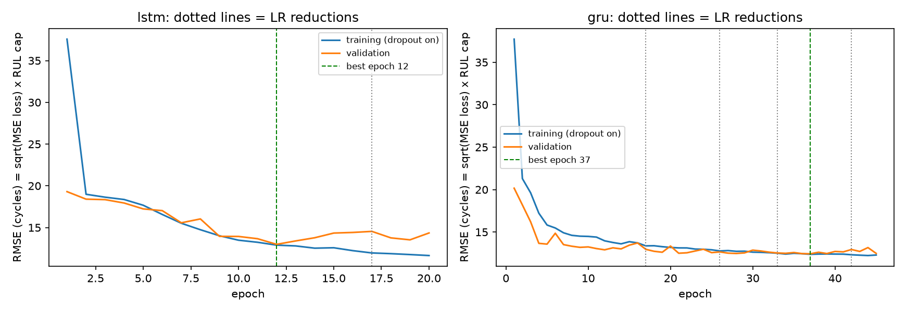
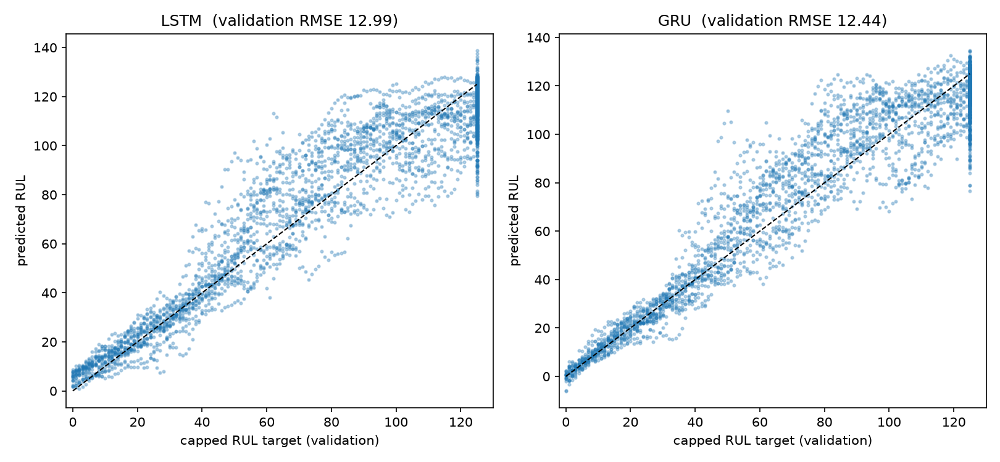

# Session 4: recurrent architectures (LSTM, GRU)

Config `configs/session4_recurrent.yaml`, seed 42, target `capped`, device `cpu`. Architectures were selected on validation data only; the test set was evaluated once, for the two selected models.

## 1. Architecture

Input `[batch, time, 14 sensors]` (Session 1 windows, no tabular features) -> LSTM or GRU (`batch_first=True`, stacked, inter-layer dropout) -> hidden state of the last time step of the top layer -> dropout -> `Linear(hidden, 1)` -> RUL. No attention.

## 2. Training protocol

Adam (lr 0.001), MSE loss on RUL / 125, batch 256, max 60 epochs, gradient-norm clipping at 1.0, ReduceLROnPlateau (factor 0.5, patience 3) and early stopping (patience 8, min delta 1e-05) both on the validation loss; the best validation checkpoint is restored. One seed per configuration. CPU runs are repeatable; MPS/CUDA kernels are not guaranteed to be bit-reproducible.

## 3. Reference run (stability gate)

LSTM hidden=64 layers=1 dropout=0.0: training loss 0.1226 -> 0.0078, best validation loss 0.0109 (epoch 12), validation predictions in [-0.6, 134.4], max gradient norm 1.53, mean fraction of clipped steps 0.01. Tiny-batch overfit: loss 0.4220 -> 0.00000. All checks passed: True.

## 4. Windows per sequence length

| L | train | validation | test |
|---|---|---|---|
| 20 | 15259 | 3472 | 100 |
| 30 | 14459 | 3272 | 100 |

Alternative lengths reuse the Session 1 split and scaler (windows only are regenerated). L=50 is not possible because some FD001 test engines have only 31 cycles and Session 1 does not pad.

## 5. LSTM ablation (L=30, validation)

| hidden_size | num_layers | dropout | val_rmse | val_mae | val_r2 | val_nasa | n_parameters | best_epoch | epochs_run | train_time_s | latency_ms | status | chosen |
|---|---|---|---|---|---|---|---|---|---|---|---|---|---|
| 32 | 1 | 0.0 | 13.942 | 9.924 | 0.8866 | 12276 | 6177 | 19 | 27 | 8.3 | 2.52 | ok |  |
| 32 | 1 | 0.2 | 13.937 | 10.051 | 0.8867 | 11792 | 6177 | 19 | 27 | 8.3 | 2.52 | ok |  |
| 32 | 2 | 0.0 | 12.990 | 9.652 | 0.9016 | 9221 | 14625 | 12 | 20 | 12.4 | 5.00 | ok | yes |
| 32 | 2 | 0.2 | 14.001 | 9.999 | 0.8856 | 13703 | 14625 | 12 | 20 | 13.2 | 5.02 | ok |  |
| 64 | 1 | 0.0 | 13.077 | 9.328 | 0.9002 | 11987 | 20545 | 12 | 20 | 12.4 | 5.00 | ok |  |
| 64 | 1 | 0.2 | 13.006 | 9.186 | 0.9013 | 10825 | 20545 | 19 | 27 | 15.6 | 4.95 | ok |  |
| 64 | 2 | 0.0 | 13.839 | 9.740 | 0.8883 | 14778 | 53825 | 9 | 17 | 19.9 | 9.57 | ok |  |
| 64 | 2 | 0.2 | 13.586 | 9.916 | 0.8923 | 12506 | 53825 | 11 | 19 | 24.4 | 9.95 | ok |  |
| 128 | 1 | 0.0 | 13.390 | 9.542 | 0.8954 | 11588 | 73857 | 10 | 18 | 18.5 | 8.07 | ok |  |
| 128 | 1 | 0.2 | 13.367 | 9.715 | 0.8958 | 12255 | 73857 | 14 | 22 | 22.7 | 8.08 | ok |  |
| 128 | 2 | 0.0 | 13.441 | 9.557 | 0.8946 | 12072 | 205953 | 9 | 17 | 37.6 | 17.53 | ok |  |
| 128 | 2 | 0.2 | 13.794 | 9.523 | 0.8890 | 15312 | 205953 | 14 | 22 | 53.5 | 17.57 | ok |  |

Stage A rule: lowest validation rmse; candidates within 1% of the best (12.990, 3 equivalent) -> fewest parameters.

## 5. GRU ablation (L=30, validation)

| hidden_size | num_layers | dropout | val_rmse | val_mae | val_r2 | val_nasa | n_parameters | best_epoch | epochs_run | train_time_s | latency_ms | status | chosen |
|---|---|---|---|---|---|---|---|---|---|---|---|---|---|
| 32 | 1 | 0.0 | 12.716 | 9.425 | 0.9057 | 8915 | 4641 | 34 | 42 | 10.6 | 1.66 | ok |  |
| 32 | 1 | 0.2 | 12.896 | 9.562 | 0.9030 | 9955 | 4641 | 25 | 33 | 8.4 | 1.66 | ok |  |
| 32 | 2 | 0.0 | 12.864 | 9.544 | 0.9035 | 10202 | 10977 | 28 | 36 | 18.9 | 3.29 | ok |  |
| 32 | 2 | 0.2 | 12.869 | 9.552 | 0.9034 | 10539 | 10977 | 23 | 31 | 17.6 | 3.27 | ok |  |
| 64 | 1 | 0.0 | 12.629 | 9.360 | 0.9070 | 10006 | 15425 | 12 | 20 | 9.1 | 3.10 | ok |  |
| 64 | 1 | 0.2 | 12.440 | 9.038 | 0.9097 | 9168 | 15425 | 37 | 45 | 21.5 | 3.10 | ok | yes |
| 64 | 2 | 0.0 | 12.862 | 9.328 | 0.9035 | 10050 | 40385 | 13 | 21 | 20.4 | 6.23 | ok |  |
| 64 | 2 | 0.2 | 12.971 | 9.573 | 0.9019 | 10414 | 40385 | 12 | 20 | 21.2 | 7.32 | ok |  |
| 128 | 1 | 0.0 | 12.541 | 8.851 | 0.9083 | 10318 | 55425 | 19 | 27 | 23.8 | 5.43 | ok |  |
| 128 | 1 | 0.2 | 12.673 | 9.162 | 0.9063 | 10651 | 55425 | 21 | 29 | 25.1 | 5.36 | ok |  |
| 128 | 2 | 0.0 | 12.935 | 9.661 | 0.9024 | 10072 | 154497 | 14 | 22 | 40.4 | 11.74 | ok |  |
| 128 | 2 | 0.2 | 12.727 | 9.037 | 0.9055 | 9992 | 154497 | 19 | 27 | 54.6 | 13.51 | ok |  |

Stage A rule: lowest validation rmse; candidates within 1% of the best (12.440, 2 equivalent) -> fewest parameters.

## 6. Sequence length (common validation endpoints)

LSTM:

| sequence_length | n_common_windows | rmse | mae | r2 | nasa_score |
|---|---|---|---|---|---|
| 20 | 3272 | 15.274 | 11.035 | 0.8639 | 14753 |
| 30 | 3272 | 12.990 | 9.652 | 0.9016 | 9221 |

GRU:

| sequence_length | n_common_windows | rmse | mae | r2 | nasa_score |
|---|---|---|---|---|---|
| 20 | 3272 | 14.932 | 11.198 | 0.8699 | 14490 |
| 30 | 3272 | 12.440 | 9.038 | 0.9097 | 9168 |

## 7. Selected models

| model | architecture | eval_set | rmse | mae | r2 | nasa |
|---|---|---|---|---|---|---|
| lstm | hidden=32 layers=2 dropout=0.0, L=30 | validation | 12.990 | 9.652 | 0.9016 | 9220.7 |
| lstm | hidden=32 layers=2 dropout=0.0, L=30 | test | 13.857 | 10.440 | 0.8804 | 306.7 |
| gru | hidden=64 layers=1 dropout=0.2, L=30 | validation | 12.440 | 9.038 | 0.9097 | 9168.4 |
| gru | hidden=64 layers=1 dropout=0.2, L=30 | test | 14.296 | 10.708 | 0.8727 | 321.0 |

NASA score is a sum, so validation (thousands of windows) and test (100) are not comparable; targets are capped at 125 on every split.

Efficiency (timings vary between runs):

| model | parameters | best_epoch | epochs_run | train_time_s | latency_ms_batch | throughput | size_bytes |
|---|---|---|---|---|---|---|---|
| lstm | 14625 | 12 | 20 | 14.9 | 5.06 | 50636 | 63262 |
| gru | 15425 | 37 | 45 | 22.2 | 3.10 | 82493 | 65645 |

## 8. Figures

## 9. Unstable or failed runs

None: every run trained without non-finite loss or gradient values.

## 10. Reproducibility

Retraining the selected configuration through the Session 2 engine gave weights identical to the ablation run: lstm=True, gru=True. Checkpoints reload to identical predictions: lstm=True, gru=True.

## 11. Scientific caveats and interpretation

- **Single seed.** Each configuration was trained once, with one seed. Small differences between configurations should not be over-interpreted. The ablation supports model selection within this controlled experiment; it does not measure run-to-run variance across seeds, and no claim of statistical superiority is made.
- **Validation and test ordering.** On validation the GRU was better than the LSTM (RMSE about 12.440 vs 12.990). On the final test the LSTM was better (RMSE about 13.857 vs 14.296). Both architectures were selected using validation data only, and the test results did not alter either selection. The reversal is reported as an observation and was not used for any retuning.
- **Unconstrained output.** The regression head is unconstrained, so predictions are not forced into [0, 125] although the training target is capped at 125. Validation predictions ranged from about 1.0 to 138.8 (LSTM) and about -6.0 to 134.6 (GRU); test predictions stayed within about 3.5 to 131.7. No clipping was added after seeing results, and all reported metrics use the raw model predictions.
- **Training time.** Training time is the total wall-clock time of the fit call and depends partly on early stopping. The selected LSTM trained for about 20 epochs and the GRU for about 45, so the raw comparison reflects both per-epoch cost and the number of epochs needed before stopping.
- **Dropout in 1-layer models.** Dropout between recurrent layers applies only when `num_layers > 1`. For 1-layer models the configured dropout acts only before the regression head, so the dropout ablation is less informative for 1-layer configurations than for 2-layer ones.
