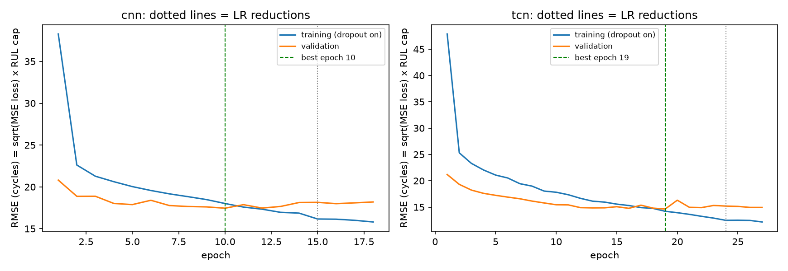
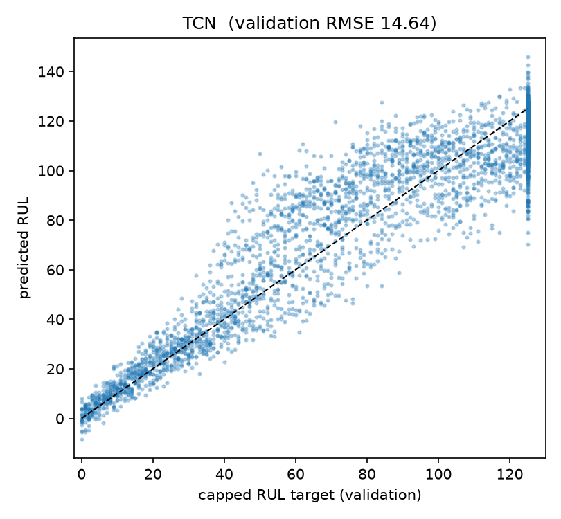
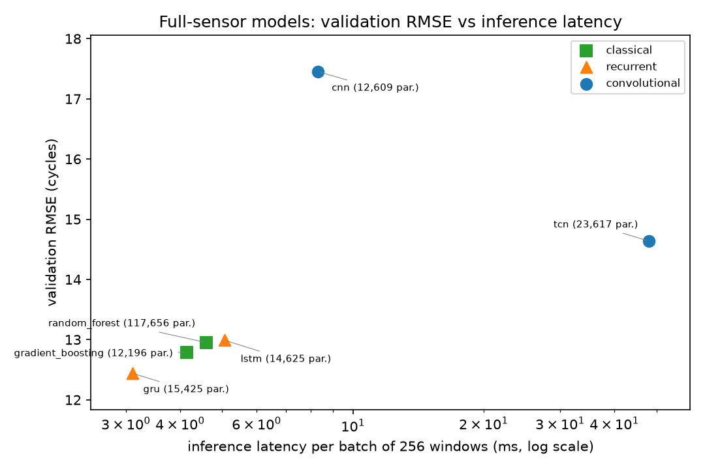

# Session 5: temporal CNN and TCN

Config `configs/session5_convolutional.yaml`, seed 42, target `capped`, device `cpu`. Architectures were selected on validation data only; the test set was evaluated once, for the final selected convolutional architecture.

## 1. Purpose

Do convolutional temporal models capture engine degradation as well as recurrent ones, without recurrent computation? A plain 1D-CNN (minimal baseline) and a residual TCN are compared with each other and with the frozen classical (Session 3) and recurrent (Session 4) models on the same full-sensor data.

## 2. Architectures and tensor shapes

Input `[B, 30, 14]` (Session 1 windows, no tabular features) is transposed inside the model to `[B, 14, 30]` for `Conv1d`; stored arrays are unchanged. Output is one RUL per window, `[B]`, in cycles (targets are divided by 125 internally, as in Session 4).

- **Plain 1D-CNN:** `depth` x (`Conv1d`, stride 1, no padding -> ReLU -> dropout); the time axis shrinks by `kernel_size - 1` per layer; readout = last time step -> dropout -> `Linear(channels, 1)` (the head dropout is applied in addition to the dropout after the last convolution).
- **TCN:** one residual block per dilation: causal `Conv1d` -> ReLU -> dropout -> causal `Conv1d` -> ReLU -> dropout, plus the block input (1x1 projection when the channel count changes), then ReLU. Causal = left zero padding of `(kernel_size - 1) x dilation`, so the time axis keeps length 30 and no output depends on later cycles; readout = last time step -> dropout -> `Linear(channels, 1)` (the head dropout is applied in addition to the dropout inside the last block).

## 3. Receptive field

TCN: `RF = 1 + 2 x (kernel_size - 1) x sum(dilations)` (two convolutions per block). Plain CNN: `RF = 1 + depth x (kernel_size - 1)`. Example: kernel 3, dilations [1, 2, 4] -> 1 + 2 x 2 x 7 = 29.

| family | kernel_size | depth_or_dilations | receptive_field | vs_window |
|---|---|---|---|---|
| cnn | 3 | 2 | 5 | within window |
| cnn | 3 | 3 | 7 | within window |
| cnn | 5 | 2 | 9 | within window |
| cnn | 5 | 3 | 13 | within window |
| tcn | 3 | [1, 2, 4] | 29 | within window |
| tcn | 3 | [1, 2, 4, 8] | 61 | exceeds window (extra positions are zero padding) |
| tcn | 5 | [1, 2, 4] | 57 | exceeds window (extra positions are zero padding) |
| tcn | 5 | [1, 2, 4, 8] | 121 | exceeds window (extra positions are zero padding) |

An RF above 30 means the extra positions fall on zero padding; the model still sees at most 30 real cycles.

## 4. Search space and protocol

CNN: channels [32, 64] x kernel [3, 5] x depth [2, 3] (8 candidates). TCN: channels [32, 64] x kernel [3, 5] x dilations [[1, 2, 4], [1, 2, 4, 8]] (8 candidates). Dropout 0.1 for all. L=30, 14 sensors.

Training protocol identical to Session 4 (checked at start): Adam lr 0.001, MSE on RUL / 125, batch 256, max 60 epochs, gradient clipping 1.0, ReduceLROnPlateau (factor 0.5, patience 3), early stopping on validation loss (patience 8, min delta 1e-05), best validation weights restored. Selection: lowest validation rmse; within 1% of the best is equivalent; then fewest parameters, then lower inference latency, then grid order.

## 5. Stability gate

| family | first_loss | last_loss | relative_drop | passed |
|---|---|---|---|---|
| cnn | 0.5097 | 0.00869 | 0.983 | True |
| tcn | 0.7327 | 0.00301 | 0.996 | True |

Each family had to overfit a 64-window batch with finite predictions before the study started.

## 6. CNN candidates (validation)

| channels | kernel_size | depth_or_dilations | receptive_field | n_parameters | val_rmse | val_mae | val_r2 | val_nasa | best_epoch | epochs_run | train_time_s | latency_ms | status | chosen |
|---|---|---|---|---|---|---|---|---|---|---|---|---|---|---|
| 32 | 3 | 2 | 5 | 4513 | 17.982 | 13.264 | 0.8114 | 35024 | 31 | 39 | 29.1 | 4.00 | ok |  |
| 32 | 3 | 3 | 7 | 7617 | 18.011 | 13.341 | 0.8108 | 32700 | 9 | 17 | 18.4 | 6.07 | ok |  |
| 32 | 5 | 2 | 9 | 7457 | 17.627 | 13.029 | 0.8187 | 31035 | 21 | 29 | 25.1 | 5.21 | ok |  |
| 32 | 5 | 3 | 13 | 12609 | 17.451 | 12.932 | 0.8223 | 33963 | 10 | 18 | 23.2 | 8.31 | ok | yes |
| 64 | 3 | 2 | 5 | 15169 | 18.002 | 12.951 | 0.8109 | 40241 | 13 | 21 | 32.0 | 11.86 | ok |  |
| 64 | 3 | 3 | 7 | 27521 | 18.138 | 13.420 | 0.8081 | 35829 | 9 | 17 | 38.9 | 19.60 | ok |  |
| 64 | 5 | 2 | 9 | 25153 | 17.789 | 13.260 | 0.8154 | 33977 | 10 | 18 | 30.3 | 15.46 | ok |  |
| 64 | 5 | 3 | 13 | 45697 | 17.893 | 13.383 | 0.8132 | 38519 | 5 | 13 | 44.0 | 40.50 | ok |  |

Rule: best validation rmse 17.451; 1 candidate(s) within 1%; decided by validation metric.

Near-miss note: CNN: threshold 17.6257 (1% above the best 17.4512). The closest smaller candidate outside it is cnn_c32_k5_d2 (7,457 parameters, validation RMSE 17.6270), missing it by 0.0013 (0.01%); it was not considered equivalent, and had it fallen inside, the smaller model would have won the tie-break. The selection is therefore sensitive to the exact threshold.

## 6. TCN candidates (validation)

| channels | kernel_size | depth_or_dilations | receptive_field | n_parameters | val_rmse | val_mae | val_r2 | val_nasa | best_epoch | epochs_run | train_time_s | latency_ms | status | chosen |
|---|---|---|---|---|---|---|---|---|---|---|---|---|---|---|
| 32 | 3 | [1, 2, 4] | 29 | 17409 | 15.997 | 11.904 | 0.8507 | 24638 | 17 | 25 | 105.4 | 37.01 | ok |  |
| 32 | 3 | [1, 2, 4, 8] | 61 | 23617 | 14.637 | 11.178 | 0.8750 | 12236 | 19 | 27 | 154.2 | 48.05 | ok | yes |
| 32 | 5 | [1, 2, 4] | 57 | 28545 | 15.188 | 11.336 | 0.8654 | 15973 | 9 | 17 | 79.5 | 36.98 | ok |  |
| 32 | 5 | [1, 2, 4, 8] | 121 | 38849 | 14.851 | 11.129 | 0.8713 | 14992 | 10 | 18 | 112.3 | 52.17 | ok |  |
| 64 | 3 | [1, 2, 4] | 29 | 65537 | 15.129 | 11.412 | 0.8665 | 16191 | 9 | 17 | 128.8 | 57.56 | ok |  |
| 64 | 3 | [1, 2, 4, 8] | 61 | 90241 | 14.689 | 10.960 | 0.8741 | 15628 | 10 | 18 | 161.3 | 80.59 | ok |  |
| 64 | 5 | [1, 2, 4] | 57 | 108289 | 15.081 | 11.258 | 0.8673 | 16329 | 8 | 16 | 127.4 | 64.81 | ok |  |
| 64 | 5 | [1, 2, 4, 8] | 121 | 149377 | 15.363 | 11.958 | 0.8623 | 12032 | 4 | 12 | 123.5 | 114.79 | ok |  |

Rule: best validation rmse 14.637; 2 candidate(s) within 1%; decided by parameter count.

Near-miss note: TCN: threshold 14.7832 (1% above the best 14.6369). The closest smaller candidate outside it is tcn_c32_k3_dil1-2-4 (17,409 parameters, validation RMSE 15.9974), missing it by 1.2142 (8.21%); it was not considered equivalent, and had it fallen inside, the smaller model would have won the tie-break.

## 7. Representatives and final convolutional architecture

| model | architecture | receptive_field | n_parameters | val_rmse | val_mae | val_r2 | val_nasa | best_epoch | epochs_run | train_time_s | latency_ms | throughput |
|---|---|---|---|---|---|---|---|---|---|---|---|---|
| cnn | channels 32, kernel 5, depth 3 | 13 | 12609 | 17.451 | 12.932 | 0.8223 | 33963 | 10 | 18 | 23.2 | 8.31 | 30793 |
| tcn | channels 32, kernel 3, dilations [1, 2, 4, 8] | 61 | 23617 | 14.637 | 11.178 | 0.8750 | 12236 | 19 | 27 | 154.2 | 48.05 | 5327 |

Final convolutional architecture (for Session 7): **TCN** (channels 32, kernel 3, dilations [1, 2, 4, 8]); decided by validation metric (1 equivalent of 2).

## 8. Final test result (selected architecture only)

| eval_set | n_samples | rmse | mae | r2 | nasa_score |
|---|---|---|---|---|---|
| validation | 3272 | 14.637 | 11.178 | 0.8750 | 12235.9 |
| test | 100 | 14.555 | 11.349 | 0.8681 | 314.6 |

NASA score is a sum, so validation and test totals are not comparable.

## 9. Comparison with the frozen classical and recurrent families (full sensors)

| family | model | n_parameters | val_rmse | val_mae | val_r2 | val_nasa | latency_ms | train_time_s | test_rmse |
|---|---|---|---|---|---|---|---|---|---|
| classical | random_forest | 117656 | 12.951 | 9.551 | 0.9022 | 12517 | 4.59 | 1.8 | 11.591 |
| classical | gradient_boosting | 12196 | 12.791 | 9.268 | 0.9046 | 11788 | 4.14 | 1.1 | 12.841 |
| recurrent | lstm | 14625 | 12.990 | 9.652 | 0.9016 | 9221 | 5.06 | 14.9 | 13.857 |
| recurrent | gru | 15425 | 12.440 | 9.038 | 0.9097 | 9168 | 3.10 | 22.2 | 14.296 |
| convolutional | cnn (cnn_c32_k5_d3) | 12609 | 17.451 | 12.932 | 0.8223 | 33963 | 8.31 | 23.2 | n/a |
| convolutional | tcn (tcn_c32_k3_dil1-2-4-8) | 23617 | 14.637 | 11.178 | 0.8750 | 12236 | 48.05 | 154.2 | 14.555 |

Validation columns are the development comparison. `test_rmse` is shown only where the earlier session already evaluated that model (and for the final convolutional model); it was not used for any choice here. Parameter count for the classical models is the number of tree nodes.

Timing interpretation (this run, this machine; not an architecture-independent conclusion): TCN latency is 15.5x that of GRU (48.05 ms vs 3.10 ms per batch of 256); TCN latency is 9.5x that of LSTM (48.05 ms vs 5.06 ms per batch of 256). Latency depends on the hardware, threading and implementation.

## 10. Figures

## 11. Unstable or failed runs

None: every candidate trained without non-finite loss or gradient values.

## 12. Reproducibility

On CPU, retraining the final architecture through the Session 2 engine gave weights identical to the candidate run: True; the checkpoint reloads to identical predictions: True. MPS and CUDA kernels are not guaranteed to be bit-reproducible.

## 13. Scientific caveats and interpretation

- **Single seed.** Every configuration was trained once, with one seed. Differences between architectures of a few percent should not be presented as statistical superiority; the study supports selection within this controlled experiment and does not measure run-to-run variance.
- **Receptive field vs the window.** A theoretical receptive field larger than the 30-cycle window does not create additional observations: the extra positions lie on the zero padding to the left of the window, and the model never sees more than 30 real cycles.
- **Plain CNN receptive field.** The unpadded CNN reads out the last time step, so it sees only the last 1 + depth x (kernel_size - 1) cycles (5 to 13 of the 30). It is a deliberately minimal baseline, not a model of the whole window.
- **Timing is environment dependent.** Latency, throughput and training time were measured on the local machine (CPU) with the Session 2 protocol and vary between runs and hardware. Training time also depends on how many epochs early stopping allowed.
- **Latency in the tie-break.** Latency is the third tie-break criterion; because it is noisy, a decision that reaches it is less reproducible than one decided by RMSE or parameter count. The `decided_by` field records which level decided each selection.
- **Test set.** The test set did not participate in any architecture choice. Only the final selected convolutional architecture was evaluated on it, after the choice was frozen. Test windows differ in difficulty from validation windows, and targets are capped at 125 on every split.
- **Comparison with earlier families.** The classical and recurrent results are the frozen Session 3 and 4 rows, read unchanged from the results table. The families differ in input representation (84 tabular features vs raw windows) and in how their hyperparameters were searched, so the comparison is descriptive.
- **Unconstrained output.** The regression head is not constrained to [0, 125] and no clipping is applied; all metrics use the raw predictions.
- **Fixed dropout.** A single dropout value is used for all candidates, so dropout is not part of this ablation.
- **Sensitivity to the 1% threshold.** The equivalence rule is applied to the unrounded validation RMSE. A candidate just outside the threshold is not equivalent even if the margin is tiny (see the near-miss notes in section 6), so a representative can depend on the exact threshold.
