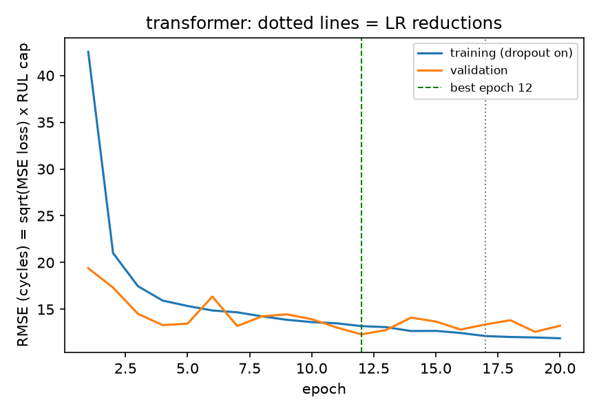
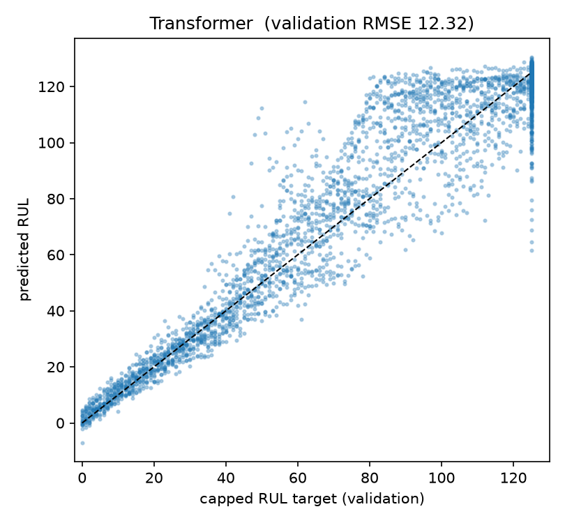
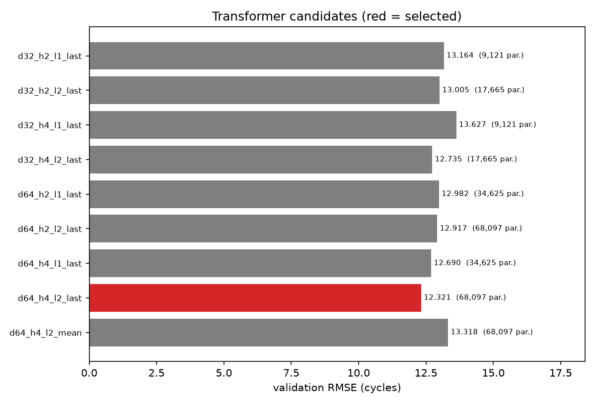
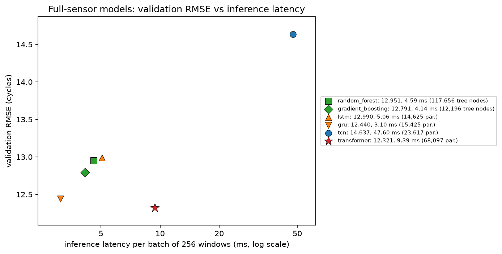

# Session 6: compact Transformer for RUL regression

Config `configs/session6_transformer.yaml`, seed 42, target `capped`, device `cpu`, commit `4738f23d55a9`.

## 1. Objective

Build a compact Transformer suited to a small multivariate prognostics dataset and decide which attention architecture to carry into Session 7.

## 2. Architecture and data flow

Input projection -> positional encoding -> dropout -> pre-norm Transformer encoder layers (`torch.nn.TransformerEncoderLayer`, `batch_first=True`; multi-head scaled dot-product self-attention and a 2x feed-forward block with relu, each with a residual connection and dropout 0.1) -> final LayerNorm -> pooling -> dropout -> `Linear(d_model, 1)`. Targets are divided by 125 in training and predictions multiplied back, as in Sessions 4 and 5. Integer-valued settings (width, heads, layers, feed-forward multiplier, sequence length, sensor count) must be true integers; fractional or boolean values are rejected, never truncated.

## 3. Tensor dimensions

| stage | shape |
|---|---|
| input windows | [B, 30, 14] |
| input projection + positions | [B, 30, 64] |
| attention weights per layer | [B, 4, 30, 30] |
| encoder output | [B, 30, 64] |
| pooled | [B, 64] |
| prediction (RUL, cycles) | [B] |

## 4. Positional encoding

Deterministic sinusoidal encoding over the cycle index 0..29 is added to the projected inputs. It has no parameters and is what lets self-attention distinguish cycle order (without it, mean pooling would be permutation invariant).

## 5. Attention-mask policy

No mask. The prediction is sequence-to-one for the last cycle of a fully observed window: all 30 cycles are available at inference, so attending across them uses nothing from the future of the prediction time, and nothing outside the window can be reached. Windows have equal length, so there is no padding to mask. A mask argument is supported and tested.

Pooling: `last` takes the final timestep's contextualised representation (emphasises the current state); `mean` averages all timesteps (aggregates the window). Through self-attention the last position can already carry information from the others. Both feed the same regression head.

## 6. Architecture grid and protocol

Stage A: d_model [32, 64] x heads [2, 4] x layers [1, 2], last pooling (8 candidates). Stage B: the leader with the other pooling. Adam lr 0.001, MSE, batch 256, max 60 epochs, clip 1.0, ReduceLROnPlateau (0.5, patience 3), early stopping on validation loss (patience 8, min delta 1e-05), best weights restored (identical to Session 4, checked at start). Selection: lowest validation RMSE; within 1% equivalent; then fewer parameters, lower latency, declared order.

## 7. Pooling comparison (validation)

| candidate | n_parameters | val_rmse | val_mae | val_r2 | val_nasa | best_epoch | epochs_run | train_loss | val_loss | train_time_s | latency_ms | throughput | status | run_id |
|---|---|---|---|---|---|---|---|---|---|---|---|---|---|---|
| tf_d64_h4_l2_last | 68097 | 12.321 | 8.315 | 0.9114 | 10654 | 12 | 20 | 0.01116 | 0.00972 | 50.6 | 9.34 | 27423 | ok | 9a73553b |
| tf_d64_h4_l2_mean | 68097 | 13.318 | 10.289 | 0.8965 | 10693 | 4 | 12 | 0.01425 | 0.01135 | 30.2 | 9.54 | 26845 | ok | 0aa323c0 |

Rule: best 12.3207; 1 of 2 within 1%; decided by validation metric.

## 8. Stability gate

| check | last | mean |
|---|---|---|
| forward shape is batch | True | True |
| loss and gradients finite | True | True |
| tiny batch loss decreases | True | True |
| predictions finite | True | True |
| target scaling inverted in predict | True | True |
| predictions in cycles | True | True |
| save load identical predictions | True | True |
| deterministic initialisation | True | True |
| deterministic training | True | True |
| device as configured | True | True |
| train and validation engines disjoint | True | True |

Tiny-batch training loss: last: 1.344 -> 0.0030; mean: 0.654 -> 0.0028.

## 9. Stage A candidate results (validation)

| candidate | n_parameters | val_rmse | val_mae | val_r2 | val_nasa | best_epoch | epochs_run | train_loss | val_loss | train_time_s | latency_ms | throughput | status | run_id |
|---|---|---|---|---|---|---|---|---|---|---|---|---|---|---|
| tf_d32_h2_l1_last | 9121 | 13.164 | 9.197 | 0.8989 | 13985 | 19 | 27 | 0.01543 | 0.01109 | 17.8 | 2.13 | 120218 | ok | b3e384a8 |
| tf_d32_h2_l2_last | 17665 | 13.005 | 9.174 | 0.9013 | 11121 | 13 | 21 | 0.01396 | 0.01082 | 26.4 | 4.12 | 62084 | ok | 2816cde9 |
| tf_d32_h4_l1_last | 9121 | 13.627 | 10.110 | 0.8917 | 12702 | 14 | 22 | 0.01692 | 0.01188 | 21.0 | 3.21 | 79721 | ok | 7728e13d |
| tf_d32_h4_l2_last | 17665 | 12.735 | 8.769 | 0.9054 | 11286 | 13 | 21 | 0.01350 | 0.01038 | 37.1 | 6.21 | 41251 | ok | 0f3f0ad2 |
| tf_d64_h2_l1_last | 34625 | 12.982 | 8.810 | 0.9017 | 11993 | 23 | 31 | 0.01237 | 0.01079 | 32.7 | 3.38 | 75749 | ok | 0c744704 |
| tf_d64_h2_l2_last | 68097 | 12.917 | 8.642 | 0.9027 | 11691 | 16 | 24 | 0.01123 | 0.01068 | 48.7 | 6.41 | 39965 | ok | dfbcf675 |
| tf_d64_h4_l1_last | 34625 | 12.690 | 8.811 | 0.9061 | 10514 | 23 | 31 | 0.01216 | 0.01031 | 40.8 | 4.70 | 54473 | ok | 94c0b47f |
| tf_d64_h4_l2_last | 68097 | 12.321 | 8.315 | 0.9114 | 10654 | 12 | 20 | 0.01116 | 0.00972 | 50.6 | 9.34 | 27423 | ok | 9a73553b |

Rule: best 12.3207; 1 of 8 within 1%; decided by validation metric.

Near-miss note (Stage A): threshold 12.4439; closest smaller candidate outside it: tf_d64_h4_l1_last (34,625 parameters, RMSE 12.6903, missed by 0.2464).

## 10. Selected Transformer

| setting | value |
|---|---|
| d_model | 64 |
| num_heads | 4 |
| num_layers | 2 |
| ff_multiplier | 2 |
| ff_dim | 128 |
| dropout | 0.1 |
| pooling | last |
| activation | relu |
| positional_encoding | sinusoidal |
| normalization | pre-norm layers + final LayerNorm |
| attention_mask | none |
| sequence_length | 30 |
| n_sensors | 14 |
| n_parameters | 68097 |

## 11-12. Validation and final test metrics

| eval_set | n_samples | rmse | mae | r2 | nasa_score |
|---|---|---|---|---|---|
| validation | 3272 | 12.321 | 8.315 | 0.9114 | 10653.6 |
| test | 100 | 12.915 | 9.688 | 0.8961 | 290.2 |

Test metrics were computed only after the architecture and pooling were frozen.

## 13-15. Parameters, training time and latency

| n_parameters | model_size_bytes | best_epoch | epochs_run | train_time_s | latency_ms_per_batch | latency_ms_per_sample | throughput_per_s |
|---|---|---|---|---|---|---|---|
| 68097 | 284038 | 12 | 20 | 50.1 | 9.39 | 0.0367 | 27259 |

## 16. Comparison with the historical families (full sensors)

| family | model | n_parameters | val_rmse | val_mae | val_r2 | val_nasa | latency_ms | train_time_s |
|---|---|---|---|---|---|---|---|---|
| classical | random_forest | 117656 | 12.951 | 9.551 | 0.9022 | 12517 | 4.59 | 1.8 |
| classical | gradient_boosting | 12196 | 12.791 | 9.268 | 0.9046 | 11788 | 4.14 | 1.1 |
| recurrent | lstm | 14625 | 12.990 | 9.652 | 0.9016 | 9221 | 5.06 | 14.9 |
| recurrent | gru | 15425 | 12.440 | 9.038 | 0.9097 | 9168 | 3.10 | 22.2 |
| convolutional | tcn | 23617 | 14.637 | 11.178 | 0.8750 | 12236 | 47.60 | 181.5 |
| attention | transformer | 68097 | 12.321 | 8.315 | 0.9114 | 10654 | 9.39 | 50.1 |

On validation RMSE the Transformer ranks 1 of 6 (12.321); the next model is gru at 12.440 (1.0% higher). This gap is within the 1% equivalence band and, from one seed, should not be read as a difference.

- Validation RMSE: Transformer 12.321 vs gru 12.440 (the best other model), a relative difference of 0.96%, i.e. less than 1%.
- Only one seed was evaluated, so no statistical superiority is claimed.
- gru has a lower validation NASA score (9,168 vs 10,654 for the Transformer).
- gru has a lower trainable parameter count (15,425 vs 68,097 for the Transformer).
- gru has a lower recorded CPU latency per batch (3.10 ms vs 9.39 ms for the Transformer).
- Previously recorded official-test RMSE is lower than the Transformer's 12.915 for: random_forest 11.591 (classical), gradient_boosting 12.841 (classical). These are observations only; no Session 6 choice used test results.
- Changing only the number of attention heads moved validation RMSE by up to 0.596 in Stage A, larger than the Transformer-versus-gru difference of 0.120.

Timing interpretation (this machine only): the Transformer has 2.0x the latency of random_forest; 2.3x the latency of gradient_boosting; 1.9x the latency of lstm; 3.0x the latency of gru; 5.1x faster than tcn.

Historical rows are the canonical Session 3-5 validation records, read from the results table without retraining. Parameter counts of the classical models are tree nodes.

## 17. Checkpoint and reproducibility

Checkpoint `checkpoints/session6/selected_transformer.pt` (file SHA-256 `4facf421dbd74df8...`, weights digest `8f267815fdc86be1...`). It reloads to identical predictions: True. Retraining the selected architecture through the Session 2 engine gave weights identical to its candidate run: True. Manifest: `artifacts/session6/manifest.json`.

**Early-stopping semantics.**

- The retained checkpoint is the best epoch under the configured minimum-improvement rule: an epoch replaces the best one only if its validation loss is lower by more than `min_delta` = 1e-05. A numerically lower loss that improves by less than that does not count (the protocol of Sessions 4 and 5).
- Selected model: retained epoch 12 is also its absolute validation-loss minimum.
- `tf_d32_h4_l1_last`: retained epoch 14 (loss 0.011884); epoch 16 was lower (0.011877) by 7.1e-06.

## 18. Scientific caveats

- **Single seed.** Every candidate was trained once with seed 42. Small differences between candidates, poolings or model families are not statistical evidence of superiority.
- **Head count does not change the parameter count.** With a fixed d_model, 2 and 4 heads have the same number of parameters, and so do the two poolings. When such candidates are within 1% of each other the tie is broken by measured latency, which is noisy; `decided_by` records when a selection reached that level.
- **Threshold sensitivity.** The 1% equivalence rule is applied to unrounded validation RMSE; a representative can depend on the exact threshold.
- **Attention over the window.** Attention is bidirectional over the 30 observed cycles (no causal mask). This uses nothing after the prediction time, but the intermediate representations are not causal.
- **Not studied.** Positional encoding (sinusoidal only), normalization (pre-norm only), dropout, feed-forward ratio, learning rate and sequence length were fixed, so no conclusion about them follows.
- **Small dataset.** FD001 training data come from 80 engines; windows overlap heavily and are not independent.
- **Timing is environment dependent.** Latency, throughput and training time were measured on one machine (CPU) and vary between runs and hardware. Training time also depends on the early-stopping epoch.
- **Test set.** Test data did not participate in any architecture or pooling choice; only the final selected Transformer was evaluated on it. Test windows differ in difficulty from validation windows, targets are capped at 125, and the NASA score is a sum (not comparable between sets of different size).
- **Unequal comparison.** Families differ in input representation (classical models use 84 tabular features), search budget and compute; parameter counts of trees (nodes) and networks are not equivalent.
- **Unconstrained output.** Predictions are not clipped to [0, 125].
- **CPU repeatability only.** MPS and CUDA kernels are not guaranteed to be bit-reproducible.

## 19. Session 7 compatibility

`artifacts/session6/selected_transformer.json` is sufficient to rebuild the model with `build_from_definition(definition, n_sensors=k)`. Only the input projection changes with k; every other hyperparameter and the training protocol stay frozen (models are retrained from scratch in Session 7).

| n_sensors | n_parameters | projection_parameters | output_shape |
|---|---|---|---|
| 14 | 68097 | 960 | (3,) |
| 10 | 67841 | 704 | (3,) |
| 7 | 67649 | 512 | (3,) |
| 4 | 67457 | 320 | (3,) |
| 2 | 67329 | 192 | (3,) |

`output_shape` is the prediction shape for a synthetic batch of three samples: `(3,)` means one scalar prediction for each of the three samples.

## 20. Optional sensor-aware variant

Not attempted. It is optional in the roadmap; a sensor-token design would be a second architecture family with its own search, would make the Session 7 comparison less direct (the token count would change with the sensor budget), and is not needed to answer this session's question.

## Unstable or failed runs

None.

## Figures

