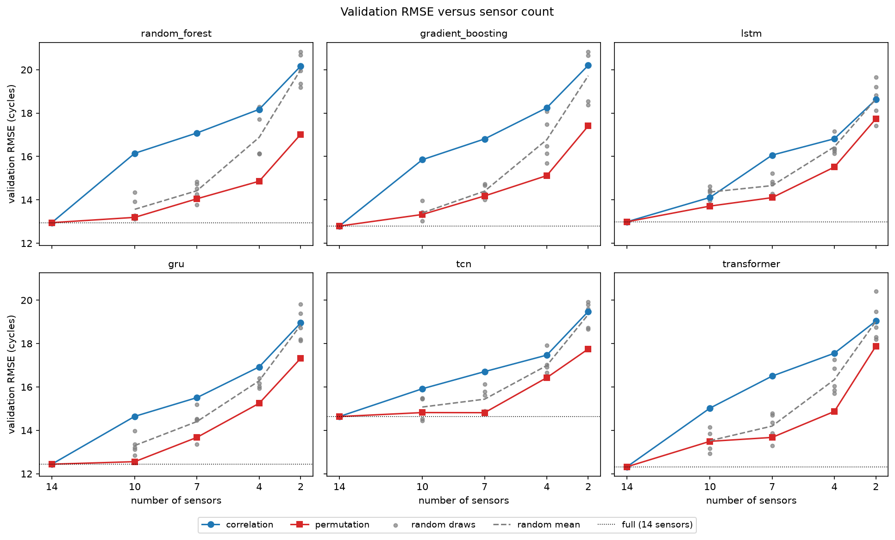
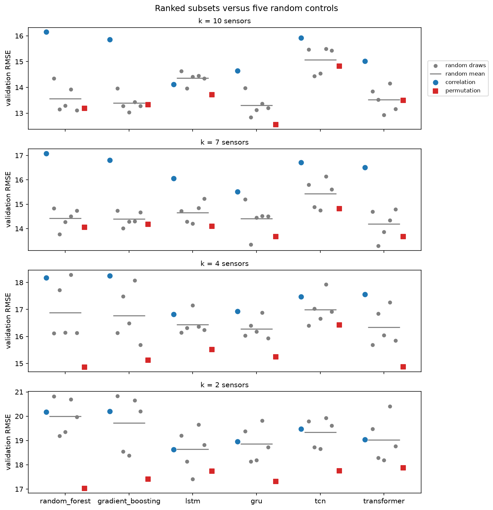
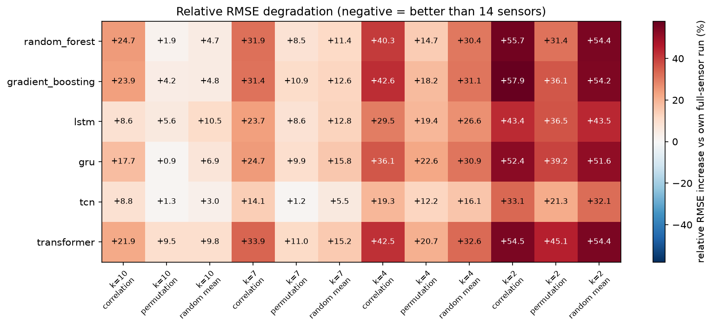
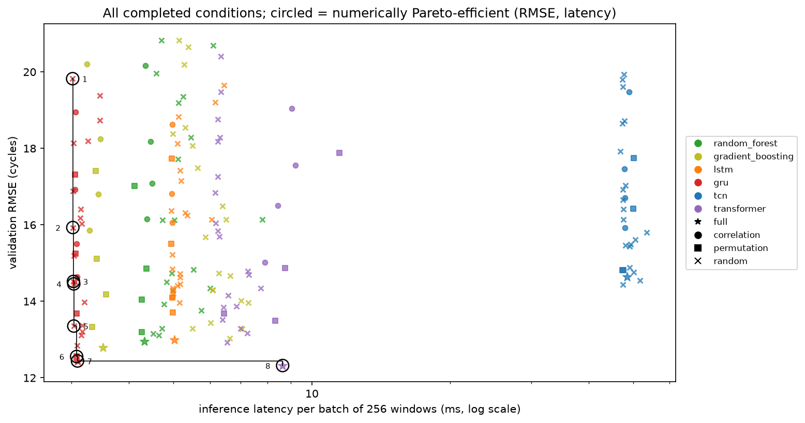
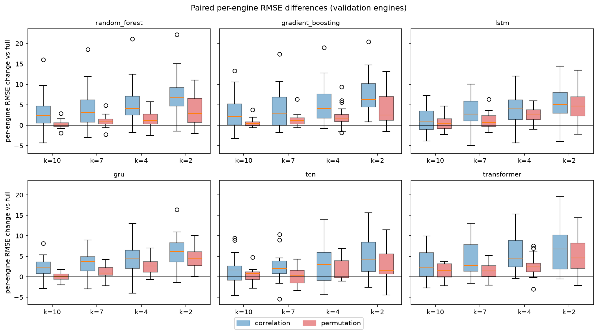

# Session 7: sensor budget x model architecture

Config `configs/session7_main_experiment.yaml`, source commit `0b7d0b3e334d`.  

**Read first.**

- All results are validation results. **No official-test evaluation was performed.**
- **Selection-contaminated:** the permutation ranking was computed from the validation labels of the same engines that score it here. Its comparisons are descriptive and do not show that permutation-based selection generalizes.
- One training seed, 20 validation engines, FD001 only.
- Latency was measured once per condition on one laptop and depends on hardware, power and load.

## 1. Research questions and hypotheses

1. How does RUL accuracy change as sensors are removed? (H: error grows as the budget shrinks.)
2. Does informed selection beat random selection? (H: ranked subsets have lower error than random ones.)
3. Which architecture is most robust to aggressive reduction? (no directional hypothesis)
4. How do accuracy, latency and sensor cost relate?
5. Can a much smaller sensor set stay within 5% of the full-sensor RMSE? (tolerance declared before training)

Short answers (details and limits in section 16):

1. Error was higher at smaller budgets overall; it rose at every step in 17 of 18 model-strategy sequences (full set first).
2. correlation subsets beat the random mean in 2 of 24 pairs; permutation (selection-contaminated) subsets beat the random mean in 24 of 24 pairs; 0 of 48 ranked-against-random tests are significant. A general advantage of informed selection is not established.
3. Descriptive only (section 12).
4. Latency differences within one model are not interpretable (section 14).
5. Within the 5% tolerance fixed in the config, the mean of the random draws: random_forest at k=10, gradient_boosting at k=10, tcn at k=10. Informed selection is therefore not shown to be necessary there. Within the tolerance, correlation subsets: no model. Within the tolerance, permutation subsets: random_forest at k=10, gradient_boosting at k=10, gru at k=10, tcn at k=7 (selection-contaminated).

## 2. Frozen data identity

FD001, RUL cap 125, engine split seed 42 (80 training / 20 validation engines), training-only scaler, window length 30. Arrays: train [14459, 30, 14], validation [3272, 30, 14]. Session 1 manifest SHA-256 `f23513005b0b9beb...`. Sensor columns are sliced in the original Session 1 order. The official test arrays are never opened.

## 3. Frozen architectures

| model | definition |
|---|---|
| random_forest | n_estimators=100, max_depth=20, min_samples_leaf=10, max_features=0.3 |
| gradient_boosting | min_samples_leaf=20, l2_regularization=1.0, max_iter=200, learning_rate=0.03, max_depth=6, max_features=1.0 |
| lstm | cell=lstm, hidden_size=32, num_layers=2, dropout=0.0, sequence_length=30 |
| gru | cell=gru, hidden_size=64, num_layers=1, dropout=0.2, sequence_length=30 |
| tcn | channels=32, kernel_size=3, dilations=[1, 2, 4, 8], dropout=0.1, sequence_length=30 |
| transformer | d_model=64, num_heads=4, num_layers=2, ff_multiplier=2, ff_dim=128, dropout=0.1, pooling=last, activation=relu, positional_encoding=sinusoidal, normalization=pre-norm layers + final LayerNorm, attention_mask=none, sequence_length=30 |

Deep models: Adam 0.001, batch 256, max 60 epochs, patience 8, min delta 1e-05, clip 1.0, ReduceLROnPlateau, targets / 125, seed 42, CPU. Classical models: Session 3 hyperparameters, six temporal features per selected sensor (6k columns), no new search.

## 4. Frozen sensor-selection strategies

Correlation (training-only) and permutation (validation) rankings and five random draws per budget (subset seeds 101-105) are read from the Session 3 artifacts. Subset seeds select sensors; the training seed is 42 for every run. Note that the permutation ranking was built from validation data, so its validation results are not independent of the selection step.

| budget | strategy | sensors |
|---|---|---|
| 14 | full | s2, s3, s4, s7, s8, s9, s11, s12, s13, s14, s15, s17, s20, s21 |
| 10 | correlation | s2, s3, s4, s7, s11, s12, s15, s17, s20, s21 |
| 10 | permutation | s2, s3, s4, s8, s9, s11, s12, s13, s14, s15 |
| 10 | random 101 | s2, s3, s7, s8, s9, s14, s15, s17, s20, s21 |
| 10 | random 102 | s2, s3, s7, s9, s11, s12, s13, s14, s17, s20 |
| 10 | random 103 | s2, s4, s8, s9, s11, s13, s14, s15, s17, s20 |
| 10 | random 104 | s2, s3, s4, s8, s9, s13, s14, s15, s17, s20 |
| 10 | random 105 | s7, s8, s9, s11, s12, s13, s14, s15, s20, s21 |
| 7 | correlation | s4, s7, s11, s12, s15, s20, s21 |
| 7 | permutation | s3, s4, s9, s11, s12, s13, s14 |
| 7 | random 101 | s4, s8, s9, s12, s14, s20, s21 |
| 7 | random 102 | s2, s3, s8, s9, s11, s13, s14 |
| 7 | random 103 | s2, s4, s7, s9, s11, s13, s15 |
| 7 | random 104 | s3, s4, s8, s9, s11, s14, s20 |
| 7 | random 105 | s3, s7, s8, s9, s13, s17, s20 |
| 4 | correlation | s4, s7, s11, s12 |
| 4 | permutation | s9, s11, s12, s14 |
| 4 | random 101 | s2, s12, s14, s21 |
| 4 | random 102 | s3, s7, s13, s20 |
| 4 | random 103 | s8, s9, s15, s17 |
| 4 | random 104 | s4, s12, s15, s20 |
| 4 | random 105 | s3, s8, s14, s20 |
| 2 | correlation | s4, s11 |
| 2 | permutation | s9, s11 |
| 2 | random 101 | s4, s17 |
| 2 | random 102 | s13, s17 |
| 2 | random 103 | s4, s8 |
| 2 | random 104 | s2, s4 |
| 2 | random 105 | s12, s20 |

## 5. Experiment matrix

174 conditions: per model one 14-sensor reference and, for k in [10, 7, 4, 2], correlation, permutation and five random subsets. Identical sensor sets are trained once. Status counts: {'completed': 174}.

## 6. Full-sensor reproducibility gate

| model | rmse | canonical_rmse | predictions_identical | weights_identical | n_parameters | passed |
|---|---|---|---|---|---|---|
| random_forest | 12.9505 | 12.9505 | True | None | 117656 | True |
| gradient_boosting | 12.7915 | 12.7915 | True | None | 12196 | True |
| lstm | 12.9900 | 12.9900 | True | True | 14625 | True |
| gru | 12.4404 | 12.4404 | True | True | 15425 | True |
| tcn | 14.6369 | 14.6369 | True | True | 23617 | True |
| transformer | 12.3207 | 12.3207 | True | True | 68097 | True |

Gate passed: True. Each full-sensor run was retrained from its frozen definition and compared with the canonical validation predictions of its session (weights too for deep models).

**Earlier gate failure (verification stage).** A first execution failed the gate for gradient_boosting (RMSE 12.8564 vs canonical 12.7915); the reduced matrix was not started. Diagnosis: subset_data returned a non-C-contiguous array from advanced indexing. The values were identical, but NumPy reductions ran in a different order, so std and slope features differed by at most 4.4e-16. The float64 histogram gradient boosting chose different splits; the random forest (float32 internally) and the deep models (contiguous float32 tensors) were unaffected. Fix: subset_data returns np.ascontiguousarray; all six full-sensor conditions are rerun because the execution code changed. The 6 superseded MLflow runs are kept and tagged `s7.status=superseded`.

This also shows that gradient boosting results here can move by a few hundredths of RMSE under changes in the last bits of the features; small gradient-boosting differences should not be interpreted.

Measured afterwards without training: 173,500 training feature values differ by at most 4.4e-16; 8 still differ after a float32 cast. Each saved model reproduces its own predictions exactly on its own feature layout: True. The two models' trees first differ at tree 46 of 200.

- Correction: The diagnosis says the random forest was unaffected because it converts features to float32. Some training values still differ after that cast (see measured_evidence.features.train); its predictions did match the canonical ones, but float32 conversion alone does not explain why.
- Limit: The source version that produced the failed run was not retained, so the cause rests on the numerical reproduction above, not on re-executing that source.
- Limit: Histogram gradient boosting on float64 features can change its tree structure after last-bit input differences; small differences between gradient-boosting results should not be interpreted.

## 7. All model-condition validation metrics

| model | budget | subset | val_rmse | val_mae | val_r2 | val_nasa_score | relative_pct | n_parameters | train_time_s | inference_latency_ms_per_batch | status | run |
|---|---|---|---|---|---|---|---|---|---|---|---|---|
| random_forest | 14 | full | 12.951 | 9.551 | 0.9022 | 12517 | +0.0 | 117656 | 1.6 | 4.32 | completed | bbfa6299 |
| gradient_boosting | 14 | full | 12.791 | 9.268 | 0.9046 | 11788 | +0.0 | 12196 | 0.9 | 3.51 | completed | dba83a60 |
| lstm | 14 | full | 12.990 | 9.652 | 0.9016 | 9221 | +0.0 | 14625 | 13.2 | 5.02 | completed | 7b39de38 |
| gru | 14 | full | 12.440 | 9.038 | 0.9097 | 9168 | +0.0 | 15425 | 20.1 | 3.09 | completed | af0b9686 |
| tcn | 14 | full | 14.637 | 11.178 | 0.8750 | 12236 | +0.0 | 23617 | 152.9 | 48.47 | completed | 61240ec2 |
| transformer | 14 | full | 12.321 | 8.315 | 0.9114 | 10654 | +0.0 | 68097 | 52.2 | 8.64 | completed | 1132ba07 |
| random_forest | 10 | correlation | 16.147 | 12.543 | 0.8479 | 18179 | +24.7 | 124392 | 1.1 | 4.37 | completed | 467a73a8 |
| random_forest | 10 | permutation | 13.194 | 9.585 | 0.8985 | 14266 | +1.9 | 119066 | 1.3 | 4.27 | completed | 6a69c1d0 |
| random_forest | 7 | correlation | 17.085 | 13.083 | 0.8297 | 24244 | +31.9 | 126082 | 0.8 | 4.50 | completed | 12490ee2 |
| random_forest | 7 | permutation | 14.051 | 10.047 | 0.8848 | 16766 | +8.5 | 120466 | 0.9 | 4.26 | completed | 3c258651 |
| random_forest | 4 | correlation | 18.173 | 13.773 | 0.8074 | 34658 | +40.3 | 128752 | 0.5 | 4.45 | completed | 8a9dbce9 |
| random_forest | 4 | permutation | 14.859 | 10.520 | 0.8712 | 18705 | +14.7 | 122596 | 0.5 | 4.37 | completed | 4e699c2d |
| random_forest | 2 | correlation | 20.167 | 15.085 | 0.7628 | 43891 | +55.7 | 132910 | 0.2 | 4.34 | completed | 543ab8be |
| random_forest | 2 | permutation | 17.021 | 11.753 | 0.8310 | 38369 | +31.4 | 128272 | 0.3 | 4.11 | completed | 6f0291ae |
| gradient_boosting | 10 | correlation | 15.852 | 12.007 | 0.8534 | 17455 | +23.9 | 12188 | 0.7 | 3.28 | completed | 8f5ffb8c |
| gradient_boosting | 10 | permutation | 13.327 | 9.627 | 0.8964 | 13502 | +4.2 | 12196 | 0.7 | 3.33 | completed | 7e5acffb |
| gradient_boosting | 7 | correlation | 16.808 | 12.571 | 0.8352 | 24283 | +31.4 | 12200 | 0.6 | 3.43 | completed | 073fb55c |
| gradient_boosting | 7 | permutation | 14.180 | 10.084 | 0.8827 | 17290 | +10.9 | 12198 | 0.7 | 3.56 | completed | 44dee362 |
| gradient_boosting | 4 | correlation | 18.245 | 13.533 | 0.8058 | 35755 | +42.6 | 12200 | 0.6 | 3.46 | completed | 74b25b86 |
| gradient_boosting | 4 | permutation | 15.118 | 10.816 | 0.8667 | 21459 | +18.2 | 12182 | 0.5 | 3.40 | completed | eb1cf1e2 |
| gradient_boosting | 2 | correlation | 20.202 | 15.106 | 0.7619 | 43470 | +57.9 | 12138 | 0.5 | 3.24 | completed | 6f7ae4b4 |
| gradient_boosting | 2 | permutation | 17.411 | 11.945 | 0.8232 | 46170 | +36.1 | 12200 | 0.5 | 3.38 | completed | 3c430496 |
| lstm | 10 | correlation | 14.111 | 10.450 | 0.8838 | 12871 | +8.6 | 14113 | 21.7 | 4.97 | completed | 9af5177b |
| lstm | 10 | permutation | 13.713 | 10.043 | 0.8903 | 11880 | +5.6 | 14113 | 13.0 | 4.98 | completed | 52d4eec0 |
| lstm | 7 | correlation | 16.063 | 12.015 | 0.8495 | 16282 | +23.7 | 13729 | 14.9 | 4.97 | completed | d2ab663d |
| lstm | 7 | permutation | 14.104 | 9.948 | 0.8840 | 15075 | +8.6 | 13729 | 23.0 | 4.97 | completed | 9a036e2a |
| lstm | 4 | correlation | 16.818 | 12.610 | 0.8350 | 20426 | +29.5 | 13345 | 17.7 | 4.96 | completed | 5487c9ca |
| lstm | 4 | permutation | 15.512 | 11.553 | 0.8596 | 16746 | +19.4 | 13345 | 14.2 | 4.94 | completed | f752daaf |
| lstm | 2 | correlation | 18.624 | 14.105 | 0.7977 | 24014 | +43.4 | 13089 | 22.0 | 4.97 | completed | 5bdb3511 |
| lstm | 2 | permutation | 17.735 | 13.163 | 0.8165 | 30116 | +36.5 | 13089 | 13.6 | 4.96 | completed | 8b426392 |
| gru | 10 | correlation | 14.645 | 11.365 | 0.8749 | 11810 | +17.7 | 14657 | 8.7 | 3.08 | completed | c0b431d5 |
| gru | 10 | permutation | 12.557 | 9.276 | 0.9080 | 9556 | +0.9 | 14657 | 19.5 | 3.08 | completed | 88790ec5 |
| gru | 7 | correlation | 15.510 | 11.757 | 0.8597 | 13772 | +24.7 | 14081 | 20.3 | 3.08 | completed | 9c8aee49 |
| gru | 7 | permutation | 13.677 | 10.011 | 0.8909 | 13055 | +9.9 | 14081 | 13.2 | 3.08 | completed | 091885aa |
| gru | 4 | correlation | 16.926 | 13.163 | 0.8329 | 18855 | +36.1 | 13505 | 14.0 | 3.06 | completed | 25ff98dd |
| gru | 4 | permutation | 15.247 | 11.387 | 0.8644 | 13815 | +22.6 | 13505 | 15.9 | 3.06 | completed | 3bef678f |
| gru | 2 | correlation | 18.954 | 14.552 | 0.7904 | 25503 | +52.4 | 13121 | 10.0 | 3.06 | completed | 7eead521 |
| gru | 2 | permutation | 17.320 | 12.937 | 0.8250 | 24710 | +39.2 | 13121 | 12.7 | 3.05 | completed | c488d9ae |
| tcn | 10 | correlation | 15.918 | 12.363 | 0.8522 | 14609 | +8.8 | 23105 | 117.0 | 48.01 | completed | 5ca3d9cc |
| tcn | 10 | permutation | 14.820 | 11.395 | 0.8719 | 12752 | +1.3 | 23105 | 116.5 | 47.60 | completed | 67d2ffef |
| tcn | 7 | correlation | 16.708 | 12.714 | 0.8372 | 18034 | +14.1 | 22721 | 149.7 | 48.03 | completed | 5a0bfb3d |
| tcn | 7 | permutation | 14.815 | 10.993 | 0.8720 | 15832 | +1.2 | 22721 | 151.1 | 47.36 | completed | 4e332d58 |
| tcn | 4 | correlation | 17.468 | 13.604 | 0.8220 | 21361 | +19.3 | 22337 | 150.5 | 47.83 | completed | 245ff802 |
| tcn | 4 | permutation | 16.429 | 12.423 | 0.8425 | 19751 | +12.2 | 22337 | 157.3 | 50.08 | completed | 69c25bbc |
| tcn | 2 | correlation | 19.482 | 14.780 | 0.7786 | 29664 | +33.1 | 22081 | 131.8 | 48.93 | completed | 7ff1666d |
| tcn | 2 | permutation | 17.752 | 13.041 | 0.8162 | 31639 | +21.3 | 22081 | 139.4 | 50.21 | completed | 295f0e65 |
| transformer | 10 | correlation | 15.024 | 10.952 | 0.8683 | 16332 | +21.9 | 67841 | 44.4 | 7.90 | completed | c2b13a10 |
| transformer | 10 | permutation | 13.494 | 10.214 | 0.8938 | 12692 | +9.5 | 67841 | 31.7 | 8.32 | completed | d0164727 |
| transformer | 7 | correlation | 16.502 | 12.088 | 0.8411 | 23328 | +33.9 | 67649 | 32.2 | 8.43 | completed | 9eb0d3a9 |
| transformer | 7 | permutation | 13.675 | 9.299 | 0.8909 | 18009 | +11.0 | 67649 | 43.9 | 6.44 | completed | d8eef005 |
| transformer | 4 | correlation | 17.557 | 13.504 | 0.8202 | 25083 | +42.5 | 67457 | 30.8 | 9.21 | completed | 50d79fdf |
| transformer | 4 | permutation | 14.872 | 10.700 | 0.8710 | 18041 | +20.7 | 67457 | 54.9 | 8.73 | completed | e6ca0205 |
| transformer | 2 | correlation | 19.039 | 13.868 | 0.7885 | 38125 | +54.5 | 67329 | 94.5 | 9.05 | completed | 592d9e28 |
| transformer | 2 | permutation | 17.880 | 12.522 | 0.8135 | 42249 | +45.1 | 67329 | 39.9 | 11.47 | completed | b54b8d81 |
| random_forest | 10 | random 101 | 14.344 | 10.507 | 0.8800 | 16297 | +10.8 | 120186 | 2.1 | 6.00 | completed | 7013ce4c |
| random_forest | 10 | random 102 | 13.154 | 9.538 | 0.8991 | 13394 | +1.6 | 118144 | 1.8 | 4.51 | completed | f8715311 |
| random_forest | 10 | random 103 | 13.291 | 9.636 | 0.8969 | 12691 | +2.6 | 119896 | 1.7 | 4.72 | completed | 7da888f4 |
| random_forest | 10 | random 104 | 13.922 | 10.059 | 0.8869 | 15026 | +7.5 | 120192 | 1.7 | 4.77 | completed | 1b080727 |
| random_forest | 10 | random 105 | 13.113 | 9.492 | 0.8997 | 13090 | +1.3 | 118722 | 1.8 | 4.64 | completed | 63ca1701 |
| random_forest | 7 | random 101 | 14.828 | 10.737 | 0.8717 | 16870 | +14.5 | 120906 | 1.2 | 5.53 | completed | 43f4b110 |
| random_forest | 7 | random 102 | 13.769 | 9.997 | 0.8894 | 13953 | +6.3 | 120168 | 1.3 | 5.75 | completed | 3dfda7ae |
| random_forest | 7 | random 103 | 14.271 | 10.371 | 0.8812 | 17759 | +10.2 | 122010 | 1.2 | 4.98 | completed | 2aa666c1 |
| random_forest | 7 | random 104 | 14.512 | 10.508 | 0.8772 | 15356 | +12.1 | 122224 | 1.2 | 4.83 | completed | 7d9664f4 |
| random_forest | 7 | random 105 | 14.731 | 10.717 | 0.8734 | 19223 | +13.7 | 122620 | 1.3 | 4.95 | completed | 0decdeef |
| random_forest | 4 | random 101 | 16.123 | 11.742 | 0.8484 | 20150 | +24.5 | 123554 | 0.7 | 5.03 | completed | d598436d |
| random_forest | 4 | random 102 | 17.722 | 13.430 | 0.8168 | 27216 | +36.8 | 128454 | 0.7 | 5.12 | completed | 2f554f1b |
| random_forest | 4 | random 103 | 16.145 | 11.771 | 0.8479 | 19964 | +24.7 | 125552 | 0.6 | 7.80 | completed | 9e094b45 |
| random_forest | 4 | random 104 | 18.289 | 13.705 | 0.8049 | 31188 | +41.2 | 129380 | 0.8 | 5.45 | completed | 0784c99d |
| random_forest | 4 | random 105 | 16.133 | 11.716 | 0.8482 | 19337 | +24.6 | 124432 | 0.7 | 4.72 | completed | c9bc2d9a |
| random_forest | 2 | random 101 | 20.822 | 15.908 | 0.7471 | 40822 | +60.8 | 134870 | 0.3 | 4.71 | completed | 63489eed |
| random_forest | 2 | random 102 | 19.190 | 14.655 | 0.7852 | 31377 | +48.2 | 134192 | 0.2 | 5.13 | completed | a4f3b4cc |
| random_forest | 2 | random 103 | 19.349 | 14.496 | 0.7816 | 35208 | +49.4 | 132416 | 0.3 | 5.24 | completed | 7215d952 |
| random_forest | 2 | random 104 | 20.687 | 15.513 | 0.7503 | 53351 | +59.7 | 132930 | 0.3 | 6.10 | completed | 833a6ab0 |
| random_forest | 2 | random 105 | 19.962 | 15.370 | 0.7675 | 37979 | +54.1 | 133568 | 0.3 | 4.58 | completed | 073739a3 |
| gradient_boosting | 10 | random 101 | 13.965 | 10.105 | 0.8862 | 15667 | +9.2 | 12200 | 1.4 | 7.27 | completed | ad71cd75 |
| gradient_boosting | 10 | random 102 | 13.283 | 9.668 | 0.8971 | 13409 | +3.8 | 12200 | 1.2 | 5.49 | completed | a131cbba |
| gradient_boosting | 10 | random 103 | 13.031 | 9.551 | 0.9009 | 11169 | +1.9 | 12200 | 1.6 | 6.63 | completed | 2b4b7a43 |
| gradient_boosting | 10 | random 104 | 13.438 | 9.633 | 0.8947 | 12659 | +5.1 | 12198 | 1.7 | 6.02 | completed | 23a9712e |
| gradient_boosting | 10 | random 105 | 13.282 | 9.455 | 0.8971 | 12512 | +3.8 | 12200 | 1.3 | 7.06 | completed | a140793c |
| gradient_boosting | 7 | random 101 | 14.737 | 10.521 | 0.8733 | 15765 | +15.2 | 12200 | 1.1 | 6.27 | completed | c45feeb8 |
| gradient_boosting | 7 | random 102 | 14.017 | 10.247 | 0.8854 | 13848 | +9.6 | 12186 | 1.1 | 7.02 | completed | 76f38dfa |
| gradient_boosting | 7 | random 103 | 14.283 | 10.124 | 0.8810 | 19705 | +11.7 | 12180 | 1.3 | 6.08 | completed | 95467bca |
| gradient_boosting | 7 | random 104 | 14.300 | 10.393 | 0.8807 | 15557 | +11.8 | 12174 | 1.2 | 6.08 | completed | eefb2223 |
| gradient_boosting | 7 | random 105 | 14.672 | 10.581 | 0.8744 | 17493 | +14.7 | 12200 | 1.3 | 6.65 | completed | 6a5fed01 |
| gradient_boosting | 4 | random 101 | 16.137 | 11.550 | 0.8481 | 20948 | +26.2 | 12194 | 1.1 | 6.51 | completed | 79f221f4 |
| gradient_boosting | 4 | random 102 | 17.490 | 12.916 | 0.8216 | 28171 | +36.7 | 12180 | 1.2 | 5.64 | completed | 9f73b946 |
| gradient_boosting | 4 | random 103 | 16.487 | 11.862 | 0.8414 | 21458 | +28.9 | 12200 | 0.9 | 6.38 | completed | f1e0bda3 |
| gradient_boosting | 4 | random 104 | 18.074 | 13.431 | 0.8094 | 30119 | +41.3 | 12186 | 1.0 | 5.50 | completed | 2dd0db1a |
| gradient_boosting | 4 | random 105 | 15.682 | 11.325 | 0.8565 | 19555 | +22.6 | 12200 | 1.0 | 5.86 | completed | 82e5f4c9 |
| gradient_boosting | 2 | random 101 | 20.830 | 15.682 | 0.7469 | 45859 | +62.8 | 12200 | 0.9 | 5.13 | completed | 812fa097 |
| gradient_boosting | 2 | random 102 | 18.544 | 13.943 | 0.7994 | 30296 | +45.0 | 12170 | 0.8 | 5.30 | completed | 5b21f675 |
| gradient_boosting | 2 | random 103 | 18.381 | 13.611 | 0.8029 | 29796 | +43.7 | 12192 | 0.8 | 4.98 | completed | be6f757e |
| gradient_boosting | 2 | random 104 | 20.657 | 15.293 | 0.7511 | 70159 | +61.5 | 12184 | 0.8 | 5.38 | completed | 30dee382 |
| gradient_boosting | 2 | random 105 | 20.194 | 15.378 | 0.7621 | 37486 | +57.9 | 12164 | 1.0 | 5.27 | completed | 80a3fc71 |
| lstm | 10 | random 101 | 14.627 | 10.899 | 0.8752 | 13282 | +12.6 | 14113 | 14.5 | 5.17 | completed | 8e653c8d |
| lstm | 10 | random 102 | 13.960 | 10.273 | 0.8863 | 12368 | +7.5 | 14113 | 15.2 | 5.15 | completed | 4fa15008 |
| lstm | 10 | random 103 | 14.410 | 10.696 | 0.8789 | 13209 | +10.9 | 14113 | 14.3 | 5.10 | completed | a1a04c60 |
| lstm | 10 | random 104 | 14.456 | 10.472 | 0.8781 | 13213 | +11.3 | 14113 | 15.9 | 5.16 | completed | 9a8cedaf |
| lstm | 10 | random 105 | 14.347 | 10.302 | 0.8799 | 12219 | +10.4 | 14113 | 14.7 | 4.98 | completed | 73f0116b |
| lstm | 7 | random 101 | 14.722 | 10.623 | 0.8736 | 13169 | +13.3 | 13729 | 15.6 | 5.16 | completed | ff59f300 |
| lstm | 7 | random 102 | 14.287 | 10.372 | 0.8809 | 14051 | +10.0 | 13729 | 15.0 | 4.98 | completed | 4b450ee4 |
| lstm | 7 | random 103 | 14.202 | 10.072 | 0.8823 | 17994 | +9.3 | 13729 | 17.8 | 5.00 | completed | 1ccde5ce |
| lstm | 7 | random 104 | 14.848 | 10.844 | 0.8714 | 14046 | +14.3 | 13729 | 15.0 | 4.97 | completed | 03c63be1 |
| lstm | 7 | random 105 | 15.226 | 11.066 | 0.8648 | 16567 | +17.2 | 13729 | 21.2 | 4.97 | completed | 9069df86 |
| lstm | 4 | random 101 | 16.138 | 11.708 | 0.8481 | 22550 | +24.2 | 13345 | 17.9 | 6.06 | completed | 48bcaba5 |
| lstm | 4 | random 102 | 16.319 | 12.089 | 0.8446 | 17840 | +25.6 | 13345 | 17.3 | 5.31 | completed | 8961b82c |
| lstm | 4 | random 103 | 17.153 | 12.490 | 0.8284 | 21655 | +32.0 | 13345 | 18.1 | 5.19 | completed | 8a8277f5 |
| lstm | 4 | random 104 | 16.363 | 11.955 | 0.8438 | 18702 | +26.0 | 13345 | 21.6 | 4.95 | completed | 6a94d206 |
| lstm | 4 | random 105 | 16.248 | 12.094 | 0.8460 | 17015 | +25.1 | 13345 | 15.7 | 5.35 | completed | 02f18b4d |
| lstm | 2 | random 101 | 19.204 | 14.684 | 0.7849 | 27739 | +47.8 | 13089 | 25.9 | 6.16 | completed | 7843eda3 |
| lstm | 2 | random 102 | 18.130 | 13.923 | 0.8083 | 25203 | +39.6 | 13089 | 17.6 | 5.10 | completed | b24470eb |
| lstm | 2 | random 103 | 17.417 | 13.038 | 0.8230 | 23565 | +34.1 | 13089 | 32.5 | 5.17 | completed | 7571456b |
| lstm | 2 | random 104 | 19.651 | 14.638 | 0.7747 | 39705 | +51.3 | 13089 | 25.6 | 6.44 | completed | c091e3d2 |
| lstm | 2 | random 105 | 18.823 | 14.728 | 0.7933 | 22098 | +44.9 | 13089 | 19.1 | 5.12 | completed | 0e53d65f |
| gru | 10 | random 101 | 13.978 | 10.311 | 0.8860 | 10890 | +12.4 | 14657 | 18.2 | 3.20 | completed | 63159e04 |
| gru | 10 | random 102 | 12.839 | 9.508 | 0.9038 | 9378 | +3.2 | 14657 | 18.4 | 3.09 | completed | 2d41fa2c |
| gru | 10 | random 103 | 13.120 | 9.651 | 0.8996 | 9886 | +5.5 | 14657 | 28.8 | 3.15 | completed | 4eb04e1f |
| gru | 10 | random 104 | 13.366 | 9.754 | 0.8958 | 11291 | +7.4 | 14657 | 27.1 | 3.17 | completed | 356bd9aa |
| gru | 10 | random 105 | 13.202 | 9.732 | 0.8983 | 10475 | +6.1 | 14657 | 18.3 | 3.17 | completed | 074c4a0e |
| gru | 7 | random 101 | 15.197 | 11.065 | 0.8653 | 15414 | +22.2 | 14081 | 7.9 | 3.04 | completed | 2cc479d9 |
| gru | 7 | random 102 | 13.353 | 9.835 | 0.8960 | 11241 | +7.3 | 14081 | 16.1 | 3.03 | completed | 357f53e2 |
| gru | 7 | random 103 | 14.456 | 10.893 | 0.8781 | 14682 | +16.2 | 14081 | 7.1 | 3.03 | completed | 80d74ad3 |
| gru | 7 | random 104 | 14.520 | 10.840 | 0.8770 | 12860 | +16.7 | 14081 | 16.2 | 3.03 | completed | 1324d3f3 |
| gru | 7 | random 105 | 14.504 | 10.702 | 0.8773 | 15519 | +16.6 | 14081 | 16.0 | 3.05 | completed | dea04fc2 |
| gru | 4 | random 101 | 16.029 | 12.008 | 0.8501 | 18656 | +28.8 | 13505 | 11.6 | 3.16 | completed | fa979873 |
| gru | 4 | random 102 | 16.407 | 12.434 | 0.8430 | 19657 | +31.9 | 13505 | 11.8 | 3.14 | completed | 83176d5b |
| gru | 4 | random 103 | 16.175 | 12.467 | 0.8474 | 17575 | +30.0 | 13505 | 10.9 | 3.13 | completed | 00d51b8c |
| gru | 4 | random 104 | 16.885 | 12.717 | 0.8337 | 18301 | +35.7 | 13505 | 10.0 | 3.02 | completed | 9fa2f949 |
| gru | 4 | random 105 | 15.930 | 12.034 | 0.8520 | 16210 | +28.1 | 13505 | 15.4 | 3.02 | completed | 38b9f3ec |
| gru | 2 | random 101 | 19.385 | 15.133 | 0.7808 | 26340 | +55.8 | 13121 | 17.7 | 3.46 | completed | d33a369e |
| gru | 2 | random 102 | 18.139 | 13.962 | 0.8081 | 23408 | +45.8 | 13121 | 10.1 | 3.03 | completed | b2575f17 |
| gru | 2 | random 103 | 18.192 | 13.871 | 0.8070 | 27217 | +46.2 | 13121 | 13.5 | 3.26 | completed | 175e05bb |
| gru | 2 | random 104 | 19.822 | 15.019 | 0.7708 | 38527 | +59.3 | 13121 | 15.2 | 3.02 | completed | c0334047 |
| gru | 2 | random 105 | 18.729 | 14.725 | 0.7954 | 22710 | +50.6 | 13121 | 14.2 | 3.46 | completed | 952274cc |
| tcn | 10 | random 101 | 15.469 | 11.550 | 0.8604 | 15571 | +5.7 | 23105 | 154.2 | 48.08 | completed | d5fe7804 |
| tcn | 10 | random 102 | 14.441 | 10.895 | 0.8784 | 13011 | -1.3 | 23105 | 119.0 | 47.52 | completed | 35a4e13e |
| tcn | 10 | random 103 | 14.540 | 10.995 | 0.8767 | 12092 | -0.7 | 23105 | 173.5 | 51.69 | completed | 14caa148 |
| tcn | 10 | random 104 | 15.493 | 11.604 | 0.8600 | 18060 | +5.8 | 23105 | 113.1 | 49.32 | completed | e8258e9c |
| tcn | 10 | random 105 | 15.437 | 11.632 | 0.8610 | 14793 | +5.5 | 23105 | 162.0 | 49.14 | completed | 9067e9ec |
| tcn | 7 | random 101 | 15.797 | 11.669 | 0.8544 | 16983 | +7.9 | 22721 | 158.3 | 53.52 | completed | 36a6c167 |
| tcn | 7 | random 102 | 14.887 | 10.922 | 0.8707 | 18468 | +1.7 | 22721 | 168.7 | 49.13 | completed | 82db0bcc |
| tcn | 7 | random 103 | 14.757 | 11.130 | 0.8730 | 17922 | +0.8 | 22721 | 149.5 | 50.12 | completed | 58cb5386 |
| tcn | 7 | random 104 | 16.136 | 12.016 | 0.8481 | 20394 | +10.2 | 22721 | 115.4 | 47.63 | completed | 1f46fd95 |
| tcn | 7 | random 105 | 15.609 | 11.889 | 0.8579 | 15889 | +6.6 | 22721 | 115.2 | 50.54 | completed | 631b885b |
| tcn | 4 | random 101 | 16.407 | 12.355 | 0.8430 | 20650 | +12.1 | 22337 | 152.9 | 47.56 | completed | 06606c8e |
| tcn | 4 | random 102 | 17.025 | 13.004 | 0.8309 | 21373 | +16.3 | 22337 | 150.9 | 48.10 | completed | 14cbdb31 |
| tcn | 4 | random 103 | 16.659 | 12.553 | 0.8381 | 19685 | +13.8 | 22337 | 177.7 | 47.50 | completed | 20db7491 |
| tcn | 4 | random 104 | 17.925 | 14.054 | 0.8126 | 20243 | +22.5 | 22337 | 100.3 | 46.92 | completed | 3ed14b43 |
| tcn | 4 | random 105 | 16.925 | 12.554 | 0.8329 | 20214 | +15.6 | 22337 | 192.8 | 47.45 | completed | 7c874092 |
| tcn | 2 | random 101 | 19.793 | 15.494 | 0.7715 | 30841 | +35.2 | 22081 | 159.7 | 47.38 | completed | 5ae5b54a |
| tcn | 2 | random 102 | 18.722 | 14.642 | 0.7955 | 30726 | +27.9 | 22081 | 132.4 | 47.83 | completed | ce8b3a17 |
| tcn | 2 | random 103 | 18.658 | 14.209 | 0.7969 | 30464 | +27.5 | 22081 | 130.0 | 47.39 | completed | f7f9fa74 |
| tcn | 2 | random 104 | 19.932 | 15.236 | 0.7683 | 35811 | +36.2 | 22081 | 115.6 | 47.78 | completed | 61617eee |
| tcn | 2 | random 105 | 19.607 | 15.229 | 0.7757 | 28036 | +34.0 | 22081 | 160.3 | 47.45 | completed | ddbfed85 |
| transformer | 10 | random 101 | 13.844 | 9.528 | 0.8882 | 13154 | +12.4 | 67841 | 72.7 | 6.42 | completed | 440ac676 |
| transformer | 10 | random 102 | 13.523 | 9.626 | 0.8933 | 16139 | +9.8 | 67841 | 34.9 | 6.40 | completed | 2fa82332 |
| transformer | 10 | random 103 | 12.931 | 8.714 | 0.9025 | 14305 | +5.0 | 67841 | 71.9 | 6.54 | completed | 219fc0f5 |
| transformer | 10 | random 104 | 14.153 | 10.364 | 0.8832 | 17414 | +14.9 | 67841 | 30.8 | 6.57 | completed | 5e378b7a |
| transformer | 10 | random 105 | 13.164 | 8.832 | 0.8989 | 14080 | +6.8 | 67841 | 56.9 | 7.24 | completed | 590b492a |
| transformer | 7 | random 101 | 14.698 | 10.251 | 0.8740 | 17993 | +19.3 | 67649 | 46.2 | 7.29 | completed | 504fcadb |
| transformer | 7 | random 102 | 13.292 | 9.220 | 0.8969 | 12746 | +7.9 | 67649 | 43.9 | 6.99 | completed | b221ce69 |
| transformer | 7 | random 103 | 13.867 | 9.318 | 0.8878 | 22423 | +12.6 | 67649 | 62.6 | 6.85 | completed | 580e325b |
| transformer | 7 | random 104 | 14.349 | 10.178 | 0.8799 | 16571 | +16.5 | 67649 | 46.9 | 7.74 | completed | 2664e2c3 |
| transformer | 7 | random 105 | 14.788 | 10.295 | 0.8724 | 26156 | +20.0 | 67649 | 61.6 | 7.25 | completed | 3f918fd5 |
| transformer | 4 | random 101 | 15.693 | 10.534 | 0.8563 | 25886 | +27.4 | 67457 | 74.8 | 6.29 | completed | 79d6f680 |
| transformer | 4 | random 102 | 16.847 | 12.191 | 0.8344 | 29013 | +36.7 | 67457 | 49.9 | 6.16 | completed | 362ba6ee |
| transformer | 4 | random 103 | 16.041 | 11.706 | 0.8499 | 20258 | +30.2 | 67457 | 40.9 | 6.18 | completed | d1becd0b |
| transformer | 4 | random 104 | 17.264 | 12.400 | 0.8261 | 26647 | +40.1 | 67457 | 50.5 | 6.24 | completed | 97abce05 |
| transformer | 4 | random 105 | 15.843 | 11.205 | 0.8536 | 24758 | +28.6 | 67457 | 50.4 | 6.25 | completed | ba9ddf62 |
| transformer | 2 | random 101 | 19.480 | 14.890 | 0.7786 | 29753 | +58.1 | 67329 | 49.9 | 6.33 | completed | 512f0b6d |
| transformer | 2 | random 102 | 18.292 | 13.628 | 0.8048 | 29596 | +48.5 | 67329 | 34.0 | 6.30 | completed | cb307362 |
| transformer | 2 | random 103 | 18.185 | 13.435 | 0.8071 | 32685 | +47.6 | 67329 | 49.9 | 6.24 | completed | 3522793a |
| transformer | 2 | random 104 | 20.412 | 15.085 | 0.7570 | 48948 | +65.7 | 67329 | 50.2 | 6.33 | completed | 366e4704 |
| transformer | 2 | random 105 | 18.759 | 14.343 | 0.7947 | 29354 | +52.3 | 67329 | 50.0 | 6.24 | completed | 4f02d3b3 |

## 8. Sensor-budget effect

**Selection-contaminated:** the permutation ranking was computed from the validation labels of the same engines that score it here. Its comparisons are descriptive and do not show that permutation-based selection generalizes.

- k=10, correlation subsets (training data only): relative RMSE change +8.6% to +24.7% (median +19.8%, 6 runs).
- k=10, permutation subsets (selection-contaminated): relative RMSE change +0.9% to +9.5% (median +3.0%, 6 runs).
- k=10, random subsets: relative RMSE change -1.3% to +14.9% (median +6.0%, 30 runs).
- k=7, correlation subsets (training data only): relative RMSE change +14.1% to +33.9% (median +28.0%, 6 runs).
- k=7, permutation subsets (selection-contaminated): relative RMSE change +1.2% to +11.0% (median +9.3%, 6 runs).
- k=7, random subsets: relative RMSE change +0.8% to +22.2% (median +12.3%, 30 runs).
- k=4, correlation subsets (training data only): relative RMSE change +19.3% to +42.6% (median +38.2%, 6 runs).
- k=4, permutation subsets (selection-contaminated): relative RMSE change +12.2% to +22.6% (median +18.8%, 6 runs).
- k=4, random subsets: relative RMSE change +12.1% to +41.3% (median +27.7%, 30 runs).
- k=2, correlation subsets (training data only): relative RMSE change +33.1% to +57.9% (median +53.4%, 6 runs).
- k=2, permutation subsets (selection-contaminated): relative RMSE change +21.3% to +45.1% (median +36.3%, 6 runs).
- k=2, random subsets: relative RMSE change +27.5% to +65.7% (median +48.3%, 30 runs).

## 9. Correlation versus permutation ranking

**Selection-contaminated:** the permutation ranking was computed from the validation labels of the same engines that score it here. Its comparisons are descriptive and do not show that permutation-based selection generalizes. This comparison was not planned and has no test.

| model | budget | correlation_rmse | permutation_rmse | permutation_minus_correlation |
|---|---|---|---|---|
| random_forest | 10 | 16.147 | 13.194 | -2.954 |
| random_forest | 7 | 17.085 | 14.051 | -3.034 |
| random_forest | 4 | 18.173 | 14.859 | -3.314 |
| random_forest | 2 | 20.167 | 17.021 | -3.145 |
| gradient_boosting | 10 | 15.852 | 13.327 | -2.525 |
| gradient_boosting | 7 | 16.808 | 14.180 | -2.628 |
| gradient_boosting | 4 | 18.245 | 15.118 | -3.127 |
| gradient_boosting | 2 | 20.202 | 17.411 | -2.791 |
| lstm | 10 | 14.111 | 13.713 | -0.398 |
| lstm | 7 | 16.063 | 14.104 | -1.960 |
| lstm | 4 | 16.818 | 15.512 | -1.307 |
| lstm | 2 | 18.624 | 17.735 | -0.888 |
| gru | 10 | 14.645 | 12.557 | -2.088 |
| gru | 7 | 15.510 | 13.677 | -1.833 |
| gru | 4 | 16.926 | 15.247 | -1.679 |
| gru | 2 | 18.954 | 17.320 | -1.633 |
| tcn | 10 | 15.918 | 14.820 | -1.098 |
| tcn | 7 | 16.708 | 14.815 | -1.892 |
| tcn | 4 | 17.468 | 16.429 | -1.039 |
| tcn | 2 | 19.482 | 17.752 | -1.731 |
| transformer | 10 | 15.024 | 13.494 | -1.530 |
| transformer | 7 | 16.502 | 13.675 | -2.827 |
| transformer | 4 | 17.557 | 14.872 | -2.685 |
| transformer | 2 | 19.039 | 17.880 | -1.159 |

## 10. Ranked versus random

**Selection-contaminated:** the permutation ranking was computed from the validation labels of the same engines that score it here. Its comparisons are descriptive and do not show that permutation-based selection generalizes. Correlation and random subsets did not use validation labels.

- correlation: lower RMSE than the random-control mean in 2 of 24 model-budget pairs and lower than all five draws in 0; per-engine tests after Holm correction: 0 significantly lower, 0 significantly higher, of 24.
- permutation: lower RMSE than the random-control mean in 24 of 24 model-budget pairs and lower than all five draws in 13; per-engine tests after Holm correction: 0 significantly lower, 0 significantly higher, of 24.

| model | budget | strategy | ranked_rmse | random_mean_rmse | random_min_rmse | random_max_rmse | random_draws_better |
|---|---|---|---|---|---|---|---|
| gradient_boosting | 10 | correlation | 15.852 | 13.400 | 13.031 | 13.965 | 5 |
| gradient_boosting | 10 | permutation | 13.327 | 13.400 | 13.031 | 13.965 | 3 |
| gradient_boosting | 7 | correlation | 16.808 | 14.402 | 14.017 | 14.737 | 5 |
| gradient_boosting | 7 | permutation | 14.180 | 14.402 | 14.017 | 14.737 | 1 |
| gradient_boosting | 4 | correlation | 18.245 | 16.774 | 15.682 | 18.074 | 5 |
| gradient_boosting | 4 | permutation | 15.118 | 16.774 | 15.682 | 18.074 | 0 |
| gradient_boosting | 2 | correlation | 20.202 | 19.721 | 18.381 | 20.830 | 3 |
| gradient_boosting | 2 | permutation | 17.411 | 19.721 | 18.381 | 20.830 | 0 |
| gru | 10 | correlation | 14.645 | 13.301 | 12.839 | 13.978 | 5 |
| gru | 10 | permutation | 12.557 | 13.301 | 12.839 | 13.978 | 0 |
| gru | 7 | correlation | 15.510 | 14.406 | 13.353 | 15.197 | 5 |
| gru | 7 | permutation | 13.677 | 14.406 | 13.353 | 15.197 | 1 |
| gru | 4 | correlation | 16.926 | 16.285 | 15.930 | 16.885 | 5 |
| gru | 4 | permutation | 15.247 | 16.285 | 15.930 | 16.885 | 0 |
| gru | 2 | correlation | 18.954 | 18.853 | 18.139 | 19.822 | 3 |
| gru | 2 | permutation | 17.320 | 18.853 | 18.139 | 19.822 | 0 |
| lstm | 10 | correlation | 14.111 | 14.360 | 13.960 | 14.627 | 1 |
| lstm | 10 | permutation | 13.713 | 14.360 | 13.960 | 14.627 | 0 |
| lstm | 7 | correlation | 16.063 | 14.657 | 14.202 | 15.226 | 5 |
| lstm | 7 | permutation | 14.104 | 14.657 | 14.202 | 15.226 | 0 |
| lstm | 4 | correlation | 16.818 | 16.444 | 16.138 | 17.153 | 4 |
| lstm | 4 | permutation | 15.512 | 16.444 | 16.138 | 17.153 | 0 |
| lstm | 2 | correlation | 18.624 | 18.645 | 17.417 | 19.651 | 2 |
| lstm | 2 | permutation | 17.735 | 18.645 | 17.417 | 19.651 | 1 |
| random_forest | 10 | correlation | 16.147 | 13.565 | 13.113 | 14.344 | 5 |
| random_forest | 10 | permutation | 13.194 | 13.565 | 13.113 | 14.344 | 2 |
| random_forest | 7 | correlation | 17.085 | 14.422 | 13.769 | 14.828 | 5 |
| random_forest | 7 | permutation | 14.051 | 14.422 | 13.769 | 14.828 | 1 |
| random_forest | 4 | correlation | 18.173 | 16.883 | 16.123 | 18.289 | 4 |
| random_forest | 4 | permutation | 14.859 | 16.883 | 16.123 | 18.289 | 0 |
| random_forest | 2 | correlation | 20.167 | 20.002 | 19.190 | 20.822 | 3 |
| random_forest | 2 | permutation | 17.021 | 20.002 | 19.190 | 20.822 | 0 |
| tcn | 10 | correlation | 15.918 | 15.076 | 14.441 | 15.493 | 5 |
| tcn | 10 | permutation | 14.820 | 15.076 | 14.441 | 15.493 | 2 |
| tcn | 7 | correlation | 16.708 | 15.437 | 14.757 | 16.136 | 5 |
| tcn | 7 | permutation | 14.815 | 15.437 | 14.757 | 16.136 | 1 |
| tcn | 4 | correlation | 17.468 | 16.988 | 16.407 | 17.925 | 4 |
| tcn | 4 | permutation | 16.429 | 16.988 | 16.407 | 17.925 | 1 |
| tcn | 2 | correlation | 19.482 | 19.342 | 18.658 | 19.932 | 2 |
| tcn | 2 | permutation | 17.752 | 19.342 | 18.658 | 19.932 | 0 |
| transformer | 10 | correlation | 15.024 | 13.523 | 12.931 | 14.153 | 5 |
| transformer | 10 | permutation | 13.494 | 13.523 | 12.931 | 14.153 | 2 |
| transformer | 7 | correlation | 16.502 | 14.199 | 13.292 | 14.788 | 5 |
| transformer | 7 | permutation | 13.675 | 14.199 | 13.292 | 14.788 | 1 |
| transformer | 4 | correlation | 17.557 | 16.338 | 15.693 | 17.264 | 5 |
| transformer | 4 | permutation | 14.872 | 16.338 | 15.693 | 17.264 | 0 |
| transformer | 2 | correlation | 19.039 | 19.026 | 18.185 | 20.412 | 3 |
| transformer | 2 | permutation | 17.880 | 19.026 | 18.185 | 20.412 | 0 |

Random controls summarised (five draws each):

| model | budget | n_draws | rmse_mean | rmse_median | rmse_std | rmse_min | rmse_max |
|---|---|---|---|---|---|---|---|
| gradient_boosting | 10 | 5 | 13.400 | 13.283 | 0.348 | 13.031 | 13.965 |
| gradient_boosting | 7 | 5 | 14.402 | 14.300 | 0.299 | 14.017 | 14.737 |
| gradient_boosting | 4 | 5 | 16.774 | 16.487 | 0.985 | 15.682 | 18.074 |
| gradient_boosting | 2 | 5 | 19.721 | 20.194 | 1.174 | 18.381 | 20.830 |
| gru | 10 | 5 | 13.301 | 13.202 | 0.424 | 12.839 | 13.978 |
| gru | 7 | 5 | 14.406 | 14.504 | 0.663 | 13.353 | 15.197 |
| gru | 4 | 5 | 16.285 | 16.175 | 0.381 | 15.930 | 16.885 |
| gru | 2 | 5 | 18.853 | 18.729 | 0.739 | 18.139 | 19.822 |
| lstm | 10 | 5 | 14.360 | 14.410 | 0.247 | 13.960 | 14.627 |
| lstm | 7 | 5 | 14.657 | 14.722 | 0.421 | 14.202 | 15.226 |
| lstm | 4 | 5 | 16.444 | 16.319 | 0.405 | 16.138 | 17.153 |
| lstm | 2 | 5 | 18.645 | 18.823 | 0.885 | 17.417 | 19.651 |
| random_forest | 10 | 5 | 13.565 | 13.291 | 0.544 | 13.113 | 14.344 |
| random_forest | 7 | 5 | 14.422 | 14.512 | 0.424 | 13.769 | 14.828 |
| random_forest | 4 | 5 | 16.883 | 16.145 | 1.045 | 16.123 | 18.289 |
| random_forest | 2 | 5 | 20.002 | 19.962 | 0.747 | 19.190 | 20.822 |
| tcn | 10 | 5 | 15.076 | 15.437 | 0.536 | 14.441 | 15.493 |
| tcn | 7 | 5 | 15.437 | 15.609 | 0.594 | 14.757 | 16.136 |
| tcn | 4 | 5 | 16.988 | 16.925 | 0.577 | 16.407 | 17.925 |
| tcn | 2 | 5 | 19.342 | 19.607 | 0.607 | 18.658 | 19.932 |
| transformer | 10 | 5 | 13.523 | 13.523 | 0.495 | 12.931 | 14.153 |
| transformer | 7 | 5 | 14.199 | 14.349 | 0.623 | 13.292 | 14.788 |
| transformer | 4 | 5 | 16.338 | 16.041 | 0.683 | 15.693 | 17.264 |
| transformer | 2 | 5 | 19.026 | 18.759 | 0.928 | 18.185 | 20.412 |

## 11. Relative degradation

`100 x (RMSE_reduced - RMSE_full) / RMSE_full` against the same model's Session 7 full-sensor run; negative values are kept.

## 12. Architecture robustness

Descriptive. Relative increases depend on each model's own full-sensor error, and the permutation rows are selection-contaminated.

- Mean relative increase over the ranked subsets and budgets, smallest first: tcn +13.9%, lstm +21.9%, gru +25.4%, random_forest +26.2%, gradient_boosting +28.2%, transformer +29.9%.
- Lowest absolute RMSE at k=2: random_forest (permutation) 17.021. Relative robustness and absolute accuracy are different criteria.

| model | strategy | full_rmse | increase_pct_k10 | increase_pct_k7 | increase_pct_k4 | increase_pct_k2 | mean_increase_pct | smallest_budget_within_tolerance |
|---|---|---|---|---|---|---|---|---|
| random_forest | correlation | 12.951 | +24.7 | +31.9 | +40.3 | +55.7 | +38.2 | - |
| random_forest | permutation | 12.951 | +1.9 | +8.5 | +14.7 | +31.4 | +14.1 | 10 |
| random_forest | random | 12.951 | +4.7 | +11.4 | +30.4 | +54.4 | +25.2 | 10 |
| gradient_boosting | correlation | 12.791 | +23.9 | +31.4 | +42.6 | +57.9 | +39.0 | - |
| gradient_boosting | permutation | 12.791 | +4.2 | +10.9 | +18.2 | +36.1 | +17.3 | 10 |
| gradient_boosting | random | 12.791 | +4.8 | +12.6 | +31.1 | +54.2 | +25.7 | 10 |
| lstm | correlation | 12.990 | +8.6 | +23.7 | +29.5 | +43.4 | +26.3 | - |
| lstm | permutation | 12.990 | +5.6 | +8.6 | +19.4 | +36.5 | +17.5 | - |
| lstm | random | 12.990 | +10.5 | +12.8 | +26.6 | +43.5 | +23.4 | - |
| gru | correlation | 12.440 | +17.7 | +24.7 | +36.1 | +52.4 | +32.7 | - |
| gru | permutation | 12.440 | +0.9 | +9.9 | +22.6 | +39.2 | +18.2 | 10 |
| gru | random | 12.440 | +6.9 | +15.8 | +30.9 | +51.6 | +26.3 | - |
| tcn | correlation | 14.637 | +8.8 | +14.1 | +19.3 | +33.1 | +18.8 | - |
| tcn | permutation | 14.637 | +1.3 | +1.2 | +12.2 | +21.3 | +9.0 | 7 |
| tcn | random | 14.637 | +3.0 | +5.5 | +16.1 | +32.1 | +14.2 | 10 |
| transformer | correlation | 12.321 | +21.9 | +33.9 | +42.5 | +54.5 | +38.2 | - |
| transformer | permutation | 12.321 | +9.5 | +11.0 | +20.7 | +45.1 | +21.6 | - |
| transformer | random | 12.321 | +9.8 | +15.2 | +32.6 | +54.4 | +28.0 | - |

Smaller sensor sets (tolerance 5%):

- random_forest (correlation): smallest budget within 5% of its full-sensor RMSE: none.
- random_forest (permutation, selection-contaminated): smallest budget within 5% of its full-sensor RMSE: 10.
- random_forest (mean of the random draws): smallest budget within 5% of its full-sensor RMSE: 10.
- gradient_boosting (correlation): smallest budget within 5% of its full-sensor RMSE: none.
- gradient_boosting (permutation, selection-contaminated): smallest budget within 5% of its full-sensor RMSE: 10.
- gradient_boosting (mean of the random draws): smallest budget within 5% of its full-sensor RMSE: 10.
- lstm (correlation): smallest budget within 5% of its full-sensor RMSE: none.
- lstm (permutation, selection-contaminated): smallest budget within 5% of its full-sensor RMSE: none.
- lstm (mean of the random draws): smallest budget within 5% of its full-sensor RMSE: none.
- gru (correlation): smallest budget within 5% of its full-sensor RMSE: none.
- gru (permutation, selection-contaminated): smallest budget within 5% of its full-sensor RMSE: 10.
- gru (mean of the random draws): smallest budget within 5% of its full-sensor RMSE: none.
- tcn (correlation): smallest budget within 5% of its full-sensor RMSE: none.
- tcn (permutation, selection-contaminated): smallest budget within 5% of its full-sensor RMSE: 7.
- tcn (mean of the random draws): smallest budget within 5% of its full-sensor RMSE: 10.
- transformer (correlation): smallest budget within 5% of its full-sensor RMSE: none.
- transformer (permutation, selection-contaminated): smallest budget within 5% of its full-sensor RMSE: none.
- transformer (mean of the random draws): smallest budget within 5% of its full-sensor RMSE: none.

## 13. Inference and model-size trade-offs

| model | budget | conditions | median_latency_ms | median_train_time_s | median_model_size_bytes | median_n_parameters |
|---|---|---|---|---|---|---|
| random_forest | 14 | 1 | 4.32 | 1.6 | 8505496 | 117656 |
| random_forest | 10 | 7 | 4.64 | 1.7 | 8666292 | 119896 |
| random_forest | 7 | 7 | 4.95 | 1.2 | 8818128 | 122010 |
| random_forest | 4 | 7 | 5.03 | 0.7 | 9072792 | 125552 |
| random_forest | 2 | 7 | 4.71 | 0.3 | 9603760 | 132930 |
| gradient_boosting | 14 | 1 | 3.51 | 0.9 | 875517 | 12196 |
| gradient_boosting | 10 | 7 | 6.02 | 1.3 | 833023 | 12200 |
| gradient_boosting | 7 | 7 | 6.08 | 1.1 | 802181 | 12198 |
| gradient_boosting | 4 | 7 | 5.64 | 1.0 | 767757 | 12194 |
| gradient_boosting | 2 | 7 | 5.13 | 0.8 | 742325 | 12184 |
| lstm | 14 | 1 | 5.02 | 13.2 | 63262 | 14625 |
| lstm | 10 | 7 | 5.10 | 14.7 | 61214 | 14113 |
| lstm | 7 | 7 | 4.97 | 15.6 | 59677 | 13729 |
| lstm | 4 | 7 | 5.19 | 17.7 | 58141 | 13345 |
| lstm | 2 | 7 | 5.12 | 22.0 | 57117 | 13089 |
| gru | 14 | 1 | 3.09 | 20.1 | 65645 | 15425 |
| gru | 10 | 7 | 3.15 | 18.4 | 62573 | 14657 |
| gru | 7 | 7 | 3.04 | 16.0 | 60268 | 14081 |
| gru | 4 | 7 | 3.06 | 11.8 | 57964 | 13505 |
| gru | 2 | 7 | 3.06 | 13.5 | 56427 | 13121 |
| tcn | 14 | 1 | 48.47 | 152.9 | 101674 | 23617 |
| tcn | 10 | 7 | 48.08 | 119.0 | 99626 | 23105 |
| tcn | 7 | 7 | 49.13 | 149.7 | 98089 | 22721 |
| tcn | 4 | 7 | 47.56 | 152.9 | 96553 | 22337 |
| tcn | 2 | 7 | 47.78 | 132.4 | 95529 | 22081 |
| transformer | 14 | 1 | 8.64 | 52.2 | 284038 | 68097 |
| transformer | 10 | 7 | 6.57 | 44.4 | 283013 | 67841 |
| transformer | 7 | 7 | 7.25 | 46.2 | 282245 | 67649 |
| transformer | 4 | 7 | 6.25 | 50.4 | 281477 | 67457 |
| transformer | 2 | 7 | 6.33 | 49.9 | 280965 | 67329 |

Classical latency includes computing the temporal features; tree 'parameters' are node counts.

## 14. Pareto analysis

A condition is Pareto-efficient if no other is at least as good in all objectives and strictly better in one. Computed programmatically over all completed conditions.

Objectives (validation RMSE, latency per batch):

| rank | model | budget | subset | val_rmse | inference_latency_ms_per_batch |
|---|---|---|---|---|---|
| 1 | gru | 2 | random 104 | 19.822 | 3.02 |
| 2 | gru | 4 | random 105 | 15.930 | 3.02 |
| 3 | gru | 7 | random 104 | 14.520 | 3.03 |
| 4 | gru | 7 | random 103 | 14.456 | 3.03 |
| 5 | gru | 7 | random 102 | 13.353 | 3.03 |
| 6 | gru | 10 | permutation | 12.557 | 3.08 |
| 7 | gru | 14 | full | 12.440 | 3.09 |
| 8 | transformer | 14 | full | 12.321 | 8.64 |

With sensor count as a third objective, 15 conditions are efficient (listed in `artifacts/session7/pareto.json`).

Read this front with care. gru: 7 efficient conditions within 0.07 ms of each other. Each latency is the median of repeated calls in a single timing block per condition, so differences this small are within machine noise: they do not show that a smaller or random subset is faster.

**Numerical versus practical membership**

- Numerical: 8 conditions are non-dominated in (RMSE, latency).
- Practical (post-hoc reading: lowest-RMSE efficient condition per model, because latency differences within a model are not interpretable): gru k=14 full (12.440 cycles, 3.1 ms); transformer k=14 full (12.321 cycles, 8.6 ms).
- Power source and concurrent load were not recorded for these runs.
- Membership among conditions of similar latency can change with timing noise. Efficient random or reduced subsets are not shown to be faster.

## 15. Planned paired statistical comparisons

Unit of analysis: validation engine (per-engine RMSE over its windows; overlapping windows are never treated as independent). Two-sided Wilcoxon signed-rank, Holm correction within each of the two predeclared families, effect size = matched-pairs rank-biserial, 95% bootstrap interval of the median difference (engines resampled). Negative difference = lower error for the ranked subset. With one training seed, these tests describe variation across engines only, not training randomness.

| family | model | budget | strategy | n_engines | median_difference | ci95_low | ci95_high | rank_biserial | p_value | p_holm | significant_after_correction |
|---|---|---|---|---|---|---|---|---|---|---|---|
| reduced_ranked_vs_full | random_forest | 10 | correlation | 20 | +2.329 | +1.015 | +3.511 | +0.76 | 0.0017 | 0.037 | True |
| reduced_ranked_vs_full | random_forest | 10 | permutation | 20 | +0.043 | -0.233 | +0.574 | +0.23 | 0.39 | 1 | False |
| reduced_ranked_vs_full | random_forest | 7 | correlation | 20 | +3.080 | +1.567 | +5.998 | +0.81 | 0.00071 | 0.018 | True |
| reduced_ranked_vs_full | random_forest | 7 | permutation | 20 | +0.834 | +0.348 | +1.274 | +0.72 | 0.0032 | 0.06 | False |
| reduced_ranked_vs_full | random_forest | 4 | correlation | 20 | +4.082 | +2.772 | +6.045 | +0.93 | 3.6e-05 | 0.0014 | True |
| reduced_ranked_vs_full | random_forest | 4 | permutation | 20 | +1.165 | +0.461 | +2.511 | +0.69 | 0.0056 | 0.073 | False |
| reduced_ranked_vs_full | random_forest | 2 | correlation | 20 | +6.757 | +5.158 | +8.445 | +0.99 | 3.8e-06 | 0.00018 | True |
| reduced_ranked_vs_full | random_forest | 2 | permutation | 20 | +2.866 | +0.830 | +6.358 | +0.87 | 0.00021 | 0.0067 | True |
| reduced_ranked_vs_full | gradient_boosting | 10 | correlation | 20 | +2.152 | +0.397 | +3.824 | +0.74 | 0.0023 | 0.049 | True |
| reduced_ranked_vs_full | gradient_boosting | 10 | permutation | 20 | +0.494 | -0.065 | +0.656 | +0.57 | 0.024 | 0.24 | False |
| reduced_ranked_vs_full | gradient_boosting | 7 | correlation | 20 | +2.826 | +0.930 | +6.132 | +0.82 | 0.00059 | 0.016 | True |
| reduced_ranked_vs_full | gradient_boosting | 7 | permutation | 20 | +1.136 | +0.510 | +1.702 | +0.86 | 0.00026 | 0.0081 | True |
| reduced_ranked_vs_full | gradient_boosting | 4 | correlation | 20 | +4.061 | +2.024 | +6.724 | +0.97 | 9.5e-06 | 0.00042 | True |
| reduced_ranked_vs_full | gradient_boosting | 4 | permutation | 20 | +1.740 | +1.117 | +2.495 | +0.72 | 0.0032 | 0.06 | False |
| reduced_ranked_vs_full | gradient_boosting | 2 | correlation | 20 | +6.282 | +4.980 | +9.657 | +1.00 | 1.9e-06 | 9.2e-05 | True |
| reduced_ranked_vs_full | gradient_boosting | 2 | permutation | 20 | +2.535 | +1.255 | +6.399 | +0.86 | 0.00026 | 0.0081 | True |
| reduced_ranked_vs_full | lstm | 10 | correlation | 20 | +0.815 | -0.787 | +2.793 | +0.35 | 0.18 | 1 | False |
| reduced_ranked_vs_full | lstm | 10 | permutation | 20 | +0.363 | -0.682 | +1.530 | +0.29 | 0.28 | 1 | False |
| reduced_ranked_vs_full | lstm | 7 | correlation | 20 | +2.755 | +1.347 | +5.252 | +0.82 | 0.00059 | 0.016 | True |
| reduced_ranked_vs_full | lstm | 7 | permutation | 20 | +0.653 | -0.207 | +1.935 | +0.55 | 0.03 | 0.24 | False |
| reduced_ranked_vs_full | lstm | 4 | correlation | 20 | +4.024 | +1.715 | +5.459 | +0.81 | 0.00071 | 0.018 | True |
| reduced_ranked_vs_full | lstm | 4 | permutation | 20 | +2.688 | +1.476 | +3.562 | +0.94 | 2.7e-05 | 0.0011 | True |
| reduced_ranked_vs_full | lstm | 2 | correlation | 20 | +5.104 | +3.218 | +6.868 | +0.93 | 3.6e-05 | 0.0014 | True |
| reduced_ranked_vs_full | lstm | 2 | permutation | 20 | +4.674 | +2.565 | +6.756 | +0.93 | 3.6e-05 | 0.0014 | True |
| reduced_ranked_vs_full | gru | 10 | correlation | 20 | +2.153 | +0.829 | +3.440 | +0.81 | 0.00071 | 0.018 | True |
| reduced_ranked_vs_full | gru | 10 | permutation | 20 | +0.132 | -0.612 | +0.582 | +0.08 | 0.78 | 1 | False |
| reduced_ranked_vs_full | gru | 7 | correlation | 20 | +3.662 | +2.015 | +4.769 | +0.83 | 0.00048 | 0.014 | True |
| reduced_ranked_vs_full | gru | 7 | permutation | 20 | +0.911 | +0.524 | +2.056 | +0.71 | 0.0037 | 0.06 | False |
| reduced_ranked_vs_full | gru | 4 | correlation | 20 | +4.346 | +2.232 | +6.028 | +0.90 | 0.0001 | 0.0036 | True |
| reduced_ranked_vs_full | gru | 4 | permutation | 20 | +2.632 | +1.272 | +3.528 | +0.94 | 2.7e-05 | 0.0011 | True |
| reduced_ranked_vs_full | gru | 2 | correlation | 20 | +6.207 | +4.249 | +8.164 | +0.99 | 3.8e-06 | 0.00018 | True |
| reduced_ranked_vs_full | gru | 2 | permutation | 20 | +4.552 | +3.148 | +5.536 | +1.00 | 1.9e-06 | 9.2e-05 | True |
| reduced_ranked_vs_full | tcn | 10 | correlation | 20 | +1.613 | -0.265 | +2.370 | +0.47 | 0.07 | 0.49 | False |
| reduced_ranked_vs_full | tcn | 10 | permutation | 20 | +0.806 | -0.483 | +1.152 | +0.25 | 0.35 | 1 | False |
| reduced_ranked_vs_full | tcn | 7 | correlation | 20 | +2.038 | +0.888 | +3.458 | +0.71 | 0.0037 | 0.06 | False |
| reduced_ranked_vs_full | tcn | 7 | permutation | 20 | +0.370 | -1.226 | +1.381 | +0.08 | 0.78 | 1 | False |
| reduced_ranked_vs_full | tcn | 4 | correlation | 20 | +3.014 | -0.479 | +4.873 | +0.64 | 0.011 | 0.12 | False |
| reduced_ranked_vs_full | tcn | 4 | permutation | 20 | +0.657 | -0.200 | +3.743 | +0.56 | 0.027 | 0.24 | False |
| reduced_ranked_vs_full | tcn | 2 | correlation | 20 | +4.262 | +2.208 | +7.147 | +0.90 | 0.0001 | 0.0036 | True |
| reduced_ranked_vs_full | tcn | 2 | permutation | 20 | +1.551 | +0.882 | +4.871 | +0.72 | 0.0032 | 0.06 | False |
| reduced_ranked_vs_full | transformer | 10 | correlation | 20 | +2.320 | +0.180 | +5.866 | +0.73 | 0.0027 | 0.054 | False |
| reduced_ranked_vs_full | transformer | 10 | permutation | 20 | +1.545 | +0.126 | +2.790 | +0.69 | 0.0056 | 0.073 | False |
| reduced_ranked_vs_full | transformer | 7 | correlation | 20 | +2.743 | +1.635 | +6.230 | +0.90 | 8.2e-05 | 0.0029 | True |
| reduced_ranked_vs_full | transformer | 7 | permutation | 20 | +1.427 | +0.141 | +2.450 | +0.70 | 0.0049 | 0.068 | False |
| reduced_ranked_vs_full | transformer | 4 | correlation | 20 | +4.367 | +2.633 | +7.139 | +0.97 | 9.5e-06 | 0.00042 | True |
| reduced_ranked_vs_full | transformer | 4 | permutation | 20 | +2.378 | +1.203 | +3.007 | +0.85 | 0.00032 | 0.0093 | True |
| reduced_ranked_vs_full | transformer | 2 | correlation | 20 | +6.753 | +3.655 | +8.977 | +0.96 | 1.3e-05 | 0.00056 | True |
| reduced_ranked_vs_full | transformer | 2 | permutation | 20 | +4.619 | +2.512 | +6.934 | +0.94 | 2.7e-05 | 0.0011 | True |
| ranked_vs_random_mean | random_forest | 10 | correlation | 20 | +1.903 | +0.151 | +3.434 | +0.57 | 0.024 | 1 | False |
| ranked_vs_random_mean | random_forest | 10 | permutation | 20 | -0.176 | -0.870 | +0.289 | -0.30 | 0.26 | 1 | False |
| ranked_vs_random_mean | random_forest | 7 | correlation | 20 | +1.839 | -0.811 | +4.594 | +0.48 | 0.064 | 1 | False |
| ranked_vs_random_mean | random_forest | 7 | permutation | 20 | -0.497 | -0.859 | -0.054 | -0.47 | 0.07 | 1 | False |
| ranked_vs_random_mean | random_forest | 4 | correlation | 20 | +1.015 | -1.734 | +3.611 | +0.32 | 0.22 | 1 | False |
| ranked_vs_random_mean | random_forest | 4 | permutation | 20 | -2.046 | -3.883 | -1.037 | -0.70 | 0.0042 | 0.2 | False |
| ranked_vs_random_mean | random_forest | 2 | correlation | 20 | +0.097 | -1.520 | +1.665 | +0.10 | 0.7 | 1 | False |
| ranked_vs_random_mean | random_forest | 2 | permutation | 20 | -3.637 | -7.075 | +0.427 | -0.56 | 0.027 | 1 | False |
| ranked_vs_random_mean | gradient_boosting | 10 | correlation | 20 | +2.670 | +0.303 | +3.768 | +0.54 | 0.033 | 1 | False |
| ranked_vs_random_mean | gradient_boosting | 10 | permutation | 20 | -0.006 | -0.506 | +0.952 | +0.03 | 0.93 | 1 | False |
| ranked_vs_random_mean | gradient_boosting | 7 | correlation | 20 | +2.361 | -1.424 | +5.065 | +0.49 | 0.058 | 1 | False |
| ranked_vs_random_mean | gradient_boosting | 7 | permutation | 20 | -0.394 | -0.832 | +0.264 | -0.25 | 0.35 | 1 | False |
| ranked_vs_random_mean | gradient_boosting | 4 | correlation | 20 | +1.372 | -1.489 | +4.233 | +0.33 | 0.2 | 1 | False |
| ranked_vs_random_mean | gradient_boosting | 4 | permutation | 20 | -2.033 | -3.039 | -0.335 | -0.62 | 0.014 | 0.63 | False |
| ranked_vs_random_mean | gradient_boosting | 2 | correlation | 20 | +0.348 | -0.529 | +1.636 | +0.23 | 0.39 | 1 | False |
| ranked_vs_random_mean | gradient_boosting | 2 | permutation | 20 | -3.837 | -6.715 | +0.243 | -0.45 | 0.083 | 1 | False |
| ranked_vs_random_mean | lstm | 10 | correlation | 20 | +0.642 | -0.598 | +1.560 | +0.15 | 0.57 | 1 | False |
| ranked_vs_random_mean | lstm | 10 | permutation | 20 | -0.762 | -1.661 | -0.018 | -0.59 | 0.019 | 0.87 | False |
| ranked_vs_random_mean | lstm | 7 | correlation | 20 | +1.136 | +0.421 | +3.422 | +0.54 | 0.033 | 1 | False |
| ranked_vs_random_mean | lstm | 7 | permutation | 20 | -0.533 | -1.011 | +0.119 | -0.33 | 0.2 | 1 | False |
| ranked_vs_random_mean | lstm | 4 | correlation | 20 | +1.555 | -2.073 | +2.193 | +0.15 | 0.57 | 1 | False |
| ranked_vs_random_mean | lstm | 4 | permutation | 20 | -0.428 | -2.409 | +1.308 | -0.30 | 0.25 | 1 | False |
| ranked_vs_random_mean | lstm | 2 | correlation | 20 | -0.234 | -1.835 | +1.805 | -0.01 | 0.99 | 1 | False |
| ranked_vs_random_mean | lstm | 2 | permutation | 20 | +0.916 | -4.413 | +1.931 | -0.20 | 0.45 | 1 | False |
| ranked_vs_random_mean | gru | 10 | correlation | 20 | +1.666 | +0.398 | +2.501 | +0.59 | 0.019 | 0.87 | False |
| ranked_vs_random_mean | gru | 10 | permutation | 20 | -0.875 | -1.302 | -0.180 | -0.64 | 0.011 | 0.5 | False |
| ranked_vs_random_mean | gru | 7 | correlation | 20 | +1.849 | -0.145 | +2.971 | +0.43 | 0.097 | 1 | False |
| ranked_vs_random_mean | gru | 7 | permutation | 20 | -1.052 | -1.350 | +0.046 | -0.52 | 0.04 | 1 | False |
| ranked_vs_random_mean | gru | 4 | correlation | 20 | +1.668 | -1.834 | +2.688 | +0.20 | 0.45 | 1 | False |
| ranked_vs_random_mean | gru | 4 | permutation | 20 | -1.393 | -3.236 | +0.567 | -0.36 | 0.16 | 1 | False |
| ranked_vs_random_mean | gru | 2 | correlation | 20 | +0.054 | -1.433 | +1.864 | +0.13 | 0.62 | 1 | False |
| ranked_vs_random_mean | gru | 2 | permutation | 20 | -0.491 | -2.870 | +0.851 | -0.36 | 0.16 | 1 | False |
| ranked_vs_random_mean | tcn | 10 | correlation | 20 | +0.841 | -0.611 | +2.127 | +0.30 | 0.25 | 1 | False |
| ranked_vs_random_mean | tcn | 10 | permutation | 20 | -0.164 | -0.919 | +0.574 | -0.26 | 0.33 | 1 | False |
| ranked_vs_random_mean | tcn | 7 | correlation | 20 | +1.535 | -0.130 | +2.953 | +0.46 | 0.076 | 1 | False |
| ranked_vs_random_mean | tcn | 7 | permutation | 20 | -0.746 | -0.889 | +0.298 | -0.46 | 0.076 | 1 | False |
| ranked_vs_random_mean | tcn | 4 | correlation | 20 | +1.137 | -1.605 | +3.583 | +0.14 | 0.6 | 1 | False |
| ranked_vs_random_mean | tcn | 4 | permutation | 20 | +0.295 | -1.921 | +1.120 | -0.20 | 0.45 | 1 | False |
| ranked_vs_random_mean | tcn | 2 | correlation | 20 | +0.529 | -1.848 | +1.958 | +0.09 | 0.76 | 1 | False |
| ranked_vs_random_mean | tcn | 2 | permutation | 20 | -1.254 | -5.508 | +1.587 | -0.31 | 0.23 | 1 | False |
| ranked_vs_random_mean | transformer | 10 | correlation | 20 | +1.452 | -0.232 | +3.795 | +0.50 | 0.048 | 1 | False |
| ranked_vs_random_mean | transformer | 10 | permutation | 20 | +0.298 | -1.292 | +1.169 | +0.00 | 1 | 1 | False |
| ranked_vs_random_mean | transformer | 7 | correlation | 20 | +1.563 | -0.569 | +4.459 | +0.52 | 0.04 | 1 | False |
| ranked_vs_random_mean | transformer | 7 | permutation | 20 | -0.422 | -1.448 | -0.007 | -0.49 | 0.058 | 1 | False |
| ranked_vs_random_mean | transformer | 4 | correlation | 20 | +2.346 | -1.158 | +3.734 | +0.30 | 0.25 | 1 | False |
| ranked_vs_random_mean | transformer | 4 | permutation | 20 | -2.478 | -3.518 | +0.841 | -0.51 | 0.044 | 1 | False |
| ranked_vs_random_mean | transformer | 2 | correlation | 20 | +0.005 | -2.488 | +1.800 | -0.04 | 0.9 | 1 | False |
| ranked_vs_random_mean | transformer | 2 | permutation | 20 | -2.632 | -4.475 | +2.648 | -0.28 | 0.29 | 1 | False |

## 16. Interpretation and limitations

### Observed validation results

- Error was higher at smaller budgets overall; it rose at every step in 17 of 18 model-strategy sequences (full set first).
- Within the 5% tolerance fixed in the config, the mean of the random draws: random_forest at k=10, gradient_boosting at k=10, tcn at k=10. Informed selection is therefore not shown to be necessary there.
- Within the tolerance, correlation subsets: no model.

### Selection-contaminated comparisons

**Selection-contaminated:** the permutation ranking was computed from the validation labels of the same engines that score it here. Its comparisons are descriptive and do not show that permutation-based selection generalizes.

- Permutation subsets had lower RMSE than the random mean in 24 of 24 model-budget pairs. The pairs share engines and subsets, so they are not independent confirmations.
- Permutation subsets had lower RMSE than correlation subsets in 24 of 24 pairs. The two methods also differ in kind (univariate last-value correlation against importance in one fitted multivariate model), not only in the data they used.
- Within the tolerance, permutation subsets: random_forest at k=10, gradient_boosting at k=10, gru at k=10, tcn at k=7.

### Statistical conclusions (20 engines)

- Reduced against full set, correlation: 19 of 24 significant after Holm correction.
- Reduced against full set, permutation: 9 of 24 significant after Holm correction (the test does not account for selection on these engines).
- Ranked against the random mean, correlation: 0 of 24 significant after Holm correction.
- Ranked against the random mean, permutation: 0 of 24 significant after Holm correction (the test does not account for selection on these engines).
- A non-significant difference is not equivalence: among the non-significant comparisons with the full set, the upper 95% limit of the median per-engine RMSE increase reaches +5.9 cycles.
- These statements describe 20 validation engines and one training seed.

### Exploratory and post-hoc findings

- The permutation-against-correlation counts, the practical reading of the Pareto front and the latency repeatability figures were examined after the results were seen. No hypothesis test supports them.
- The hypotheses in section 1 and the choice of Pareto objectives have no timestamped record before training; the tolerance, test families, correction and bootstrap settings are in the config logged with every run.

### Pareto membership

- Numerical: 8 conditions are non-dominated in (RMSE, latency).
- Practical (post-hoc reading: lowest-RMSE efficient condition per model, because latency differences within a model are not interpretable): gru k=14 full (12.440 cycles, 3.1 ms); transformer k=14 full (12.321 cycles, 8.6 ms).

### Hardware-dependent latency

- Power source and concurrent load were not recorded for these runs.
- Latency and training time depend on this machine, its load and library threading; they compare model families coarsely and say nothing reliable about sensor subsets.

### Limitations

- One training seed: differences of a few percent can come from training randomness and are not evidence of superiority.
- Validation windows overlap heavily and come from only 20 engines.
- The same validation engines were used to select architectures and hyperparameters (Sessions 3-6), for early stopping, to build the permutation ranking and to report these results. Absolute performance is optimistic for unseen engines.
- Evidence for generalization would need engines that played no part in any selection, for example engine-level cross-validation with the ranking rebuilt inside each fold. That was not done.
- Families differ in inputs (temporal features vs raw windows), original search budgets and size measures.
- Architectures were selected with all 14 sensors; they were deliberately not retuned for smaller sets.
- Only FD001 (one operating condition, one fault mode); generalisation is Session 8.

## 17. Failed or unstable conditions

None: all 174 conditions completed.

## 18. Validation / test separation

Training uses the training windows; early stopping and every reported metric use the validation windows. The test files are not opened by any Session 7 code, no condition has a test metric, and no test result influenced the plan or the analysis. Historical official-test results are unchanged. The reproducibility gate reads the historical results file and keeps only its validation rows.

## 19. Reproducibility metadata

| item | value |
|---|---|
| python | 3.11.15 |
| platform | macOS-26.5.2-arm64-arm-64bit |
| hardware | Apple M3, 8/8 physical/logical cores, 24 GiB RAM |
| torch | 2.15.0 |
| scikit-learn | 1.9.1 |
| git_commit | 0b7d0b3e334d8a3453f56bc841159f373a50872c |
| git_dirty | False |
| total_condition_time_h | 1.92 |
| conditions_with_more_than_one_attempt | 0 |
| execution_code_fingerprint | 6e0551ece05d85c9 |
| current_source_equals_execution_source | True |
| executed_between_utc | 2026-11-26T13:20:35+00:00 and 2026-11-26T15:15:53+00:00 |
| official_test_evaluation | not performed |

Software and hardware rows describe the machine that wrote this report; the execution environment of the runs is in the manifest (`execution_provenance`), with hashes of the sources that wrote this report (`report_source_hashes`).

## 20. Session 8 handoff

- `artifacts/session7/experiment_plan.json`: every condition with sensors, indices and definition hashes.
- Everything below is git-ignored and exists only locally; back it up before any cleanup.
- `results/session7/conditions/<id>.json`: status, MLflow run ID, run folder and file hashes.
- `results/session7/runs/<run_id>/`: model files and window-level validation predictions (`predictions.npz`).
- `results/session7/validation_index.npz`: engine ID, end cycle and target of each validation window.
- `results/session7/per_engine_metrics.csv`: per-engine metrics of every condition.
