# Reliability, generalisation and conclusions: sensor-reduced RUL models on NASA C-MAPSS

Session 8. Protocol: [session8_evaluation_protocol.md](session8_evaluation_protocol.md), configuration `configs/session8_evaluation.yaml`. Reproduction: [session8_reproducibility.md](session8_reproducibility.md).

**Read first.** All data are simulated. FD001 validation results are affected by selection. FD003 official-test results are the primary transfer evidence; according to the local access log and hashes (self-recorded, not externally attested) the candidates and test families were fixed before the labels were read. Permutation-ranked subsets were chosen with the FD001 validation labels. All narrative, figures and anything marked *post hoc* or *exploratory* were produced after seeing results. The results come from an uncommitted working tree and are not canonical. This text was revised after an independent audit ([session8_audit_remediation.md](session8_audit_remediation.md)).

## 1. Research objectives

Determine whether the FD001 sensor-efficiency findings hold on FD003, where the models fail, how their errors are directed, and what can be concluded.

## 2. Dataset and protocol

| Property | FD001 | FD003 |
|---|---|---|
| Operating conditions (NASA readme) | one, sea level | one, sea level |
| Fault modes (NASA readme) | HPC degradation | HPC degradation and fan degradation |
| Engines in training file | 100 (80 train / 20 validation) | 100 (all evaluation only) |
| Lifetime, min / median / max cycles | 128 / 199 / 362 | 145 / 220 / 525 |

The files give no fault label per engine. Transfer is zero-shot: the 14 FD001 sensors in order, the FD001-fitted scaler applied unchanged, 30-cycle windows, target min(RUL, 125). Three sets are scored and are not interchangeable:

- FD001 validation: 3272 windows from 20 engines.
- FD003 training trajectories: 21820 windows from 100 engines.
- FD003 official test: 100 engines, one window each (29 with true RUL<=50, 39 with 51-100, 32 above 100).

The FD001 official-test arrays were not opened. FD001 test figures quoted below are the rows recorded in Sessions 3-6 and had already been inspected.

## 3. Frozen models and subsets

The 174 canonical Session 7 models (6 architectures; 14 sensors and ranked or random subsets of 10, 7, 4, 2) were used for inference only, after each reproduced its stored FD001 predictions exactly. No model used for the results was trained or changed. Candidates, fixed from FD001 validation results:

| key | role |
|---|---|
| transformer_full | lowest FD001 validation RMSE |
| gru_full | efficiency-oriented full-sensor alternative |
| gb_full | classical reference (lowest classical validation RMSE) |
| rf_full | full-sensor architecture |
| lstm_full | full-sensor architecture |
| tcn_full | full-sensor architecture |
| gru_k10_perm | preferred reduced (lowest RMSE within tolerance); selection-contaminated |
| tcn_k07_perm | smallest budget within tolerance; selection-contaminated |
| gb_k10_random | reduced within tolerance without ranking (mean of 5 draws) |
| gru_k02_perm | aggressive reduction; selection-contaminated |
| gru_k02_corr | aggressive reduction (training-only ranking) |

## 4. FD001 baseline

| model | validation RMSE | test RMSE (already inspected) | ms per 256 windows | parameters or tree nodes | size, kB |
|---|---|---|---|---|---|
| Transformer | 12.321 | 12.915 | 8.6 | 68097 | 284 |
| GRU | 12.440 | 14.296 | 3.1 | 15425 | 66 |
| gradient boosting | 12.791 | 12.841 | 3.5 | 12196 | 876 |
| random forest | 12.951 | 11.591 | 4.3 | 117656 | 8505 |
| LSTM | 12.990 | 13.857 | 5.0 | 14625 | 63 |
| TCN | 14.637 | 14.555 | 48.5 | 23617 | 102 |

## 5. FD003 generalisation

| candidate | FD001 val RMSE | FD003 trajectory RMSE | FD003 test RMSE | 95% interval | test MAE | test R2 | test NASA |
|---|---|---|---|---|---|---|---|
| transformer_full | 12.32 | 23.78 | 30.95 | 26.2 to 35.3 | 21.90 | 0.38 | 1.13e+04 |
| gru_full | 12.44 | 22.23 | 27.52 | 23.0 to 31.9 | 19.56 | 0.51 | 1.03e+04 |
| gb_full | 12.79 | 17.60 | 20.98 | 17.9 to 24.1 | 15.78 | 0.71 | 1.71e+03 |
| rf_full | 12.95 | 18.06 | 20.02 | 17.0 to 23.0 | 15.13 | 0.74 | 1.39e+03 |
| lstm_full | 12.99 | 19.68 | 23.41 | 18.9 to 27.8 | 16.69 | 0.64 | 6.57e+03 |
| tcn_full | 14.64 | 89.87 | 116.53 | 93.3 to 138.1 | 68.66 | -7.85 | 2.09e+14 |
| gru_k10_perm | 12.56 | 23.99 | 29.59 | 24.7 to 34.2 | 20.59 | 0.43 | 1.12e+04 |
| tcn_k07_perm | 14.82 | 21.86 | 23.02 | 18.8 to 27.1 | 16.56 | 0.65 | 3.12e+03 |
| gb_k10_random | 13.40 | 18.57 | 21.42 | 18.7 to 24.0 | 16.13 | 0.69 | 2.78e+03 |
| gru_k02_perm | 17.32 | 17.07 | 18.05 | 14.1 to 22.2 | 12.54 | 0.79 | 2.54e+03 |
| gru_k02_corr | 18.95 | 17.84 | 19.99 | 16.4 to 23.8 | 14.94 | 0.74 | 2.72e+03 |

- Every full-sensor model has a higher error on FD003 test than on the FD001 official test, which uses the same one-window-per-engine protocol (already inspected in earlier sessions): 1.6 to 2.4 times without the TCN (*post hoc* grouping), 8.0 times for the TCN. FD001 validation and FD003 test RMSE are different protocols and their difference is not a pure generalisation gap.
- The TCN fails: it predicts values far above the cap on FD003 (R2 -7.9).

**Architecture order under three protocols** (RMSE, rank in brackets):

| model | FD001 validation (all windows) | FD001 test (terminal; already inspected) | FD003 test (terminal) |
|---|---|---|---|
| Transformer | 12.32 (1) | 12.91 (3) | 30.95 (5) |
| GRU | 12.44 (2) | 14.30 (5) | 27.52 (4) |
| gradient boosting | 12.79 (3) | 12.84 (2) | 20.98 (2) |
| random forest | 12.95 (4) | 11.59 (1) | 20.02 (1) |
| LSTM | 12.99 (5) | 13.86 (4) | 23.41 (3) |
| TCN | 14.64 (6) | 14.56 (6) | 116.53 (6) |

Spearman correlation of the six ranks: FD001 test with FD003 test 0.83; FD001 validation with FD003 test 0.03; FD001 validation with FD001 test 0.31. On the matched terminal protocol the order is largely similar and random forest is first on both. The difference between the FD001 validation order and the FD003 order therefore cannot be attributed to domain shift alone: much of it already appears between FD001 validation and FD001 test. Six models and one seed make these correlations very uncertain (*post hoc* analysis).

- Gap on trajectories (engine-mean RMSE, FD003 training minus FD001 validation, independent engines):

| candidate | trajectory_engine_rmse_difference | ci95_low | ci95_high |
|---|---|---|---|
| transformer_full | +8.92 | +6.02 | +11.89 |
| gru_full | +7.35 | +4.88 | +9.95 |
| gb_full | +4.28 | +1.73 | +6.70 |
| rf_full | +4.43 | +1.78 | +6.97 |
| lstm_full | +5.08 | +2.76 | +7.45 |
| tcn_full | +47.70 | +36.80 | +58.67 |
| gru_k10_perm | +8.71 | +6.24 | +11.31 |
| tcn_k07_perm | +4.73 | +2.10 | +7.33 |
| gb_k10_random | +4.47 | +1.83 | +7.04 |
| gru_k02_perm | -0.61 | -3.10 | +1.80 |
| gru_k02_corr | -1.06 | -2.95 | +1.00 |

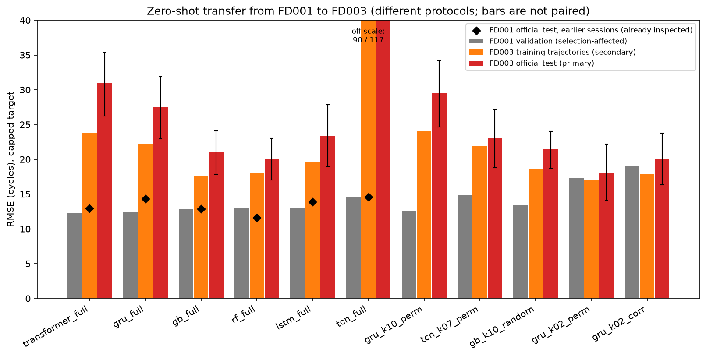

**Associated input shift (exploratory, post hoc).** FD003 moves several channels far outside the FD001 range, most clearly sensors 7 and 12, in both the training file and the test windows (figure 32). For every architecture, reduced subsets that contain either sensor transfer worse than those that do not:

| model | sensor_7_with | sensor_7_without | sensor_12_with | sensor_12_without |
|---|---|---|---|---|
| random forest | 24.7 | 20.3 | 24.7 | 20.4 |
| gradient boosting | 25.1 | 21.0 | 25.2 | 19.9 |
| LSTM | 39.2 | 21.6 | 39.7 | 21.4 |
| GRU | 40.4 | 21.3 | 43.1 | 20.8 |
| TCN | 114.9 | 26.2 | 123.4 | 25.8 |
| Transformer | 31.6 | 24.8 | 30.8 | 22.5 |

Subsets differ in several sensors at once, so this is an association, not a demonstrated cause of the TCN failure or of any other degradation; no controlled intervention was part of the protocol. The shift is consistent with the second fault mode but cannot be attributed to it without per-engine fault labels.

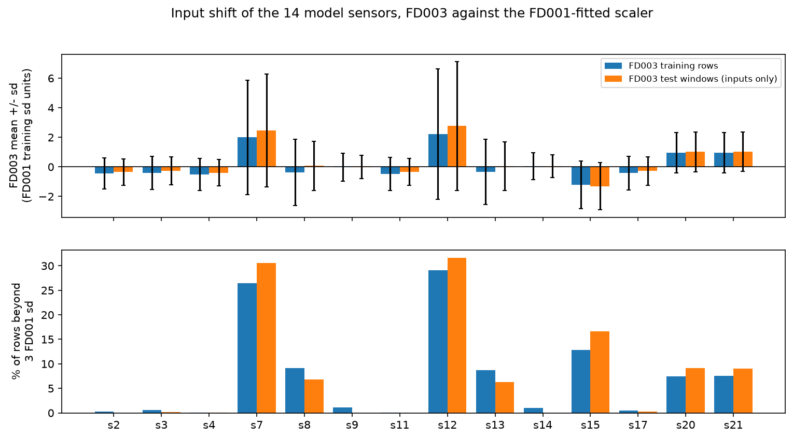

## 6. Error by RUL stage

Stages use the uncapped true RUL (identical bins under the cap). Two aggregations are used and always named: **pooled** (over all predictions of the stage) and **per engine, then averaged**. FD003 test has one prediction per engine, so there pooled is the only meaningful form.

FD003 official test (one terminal prediction per engine):

| model | stage | n_engines | RMSE | MAE | median abs error | mean signed | under_fraction | over_fraction |
|---|---|---|---|---|---|---|---|---|
| random forest | RUL<=50 | 29 | 26.06 | 21.20 | 20.82 | +20.29 | 0.10 | 0.90 |
| random forest | 51-100 | 39 | 21.02 | 16.61 | 15.48 | +14.52 | 0.18 | 0.82 |
| random forest | >100 | 32 | 9.93 | 7.83 | 6.67 | -3.65 | 0.69 | 0.31 |
| gradient boosting | RUL<=50 | 29 | 27.81 | 22.61 | 26.04 | +21.29 | 0.14 | 0.86 |
| gradient boosting | 51-100 | 39 | 21.74 | 17.21 | 17.13 | +14.38 | 0.21 | 0.79 |
| gradient boosting | >100 | 32 | 9.94 | 7.84 | 7.32 | -2.28 | 0.66 | 0.34 |
| LSTM | RUL<=50 | 29 | 26.89 | 20.83 | 21.92 | +18.63 | 0.21 | 0.79 |
| LSTM | 51-100 | 39 | 25.62 | 18.08 | 13.83 | +15.45 | 0.21 | 0.79 |
| LSTM | >100 | 32 | 16.02 | 11.27 | 8.02 | -1.07 | 0.44 | 0.56 |
| GRU | RUL<=50 | 29 | 37.39 | 30.48 | 37.03 | +28.13 | 0.21 | 0.79 |
| GRU | 51-100 | 39 | 27.07 | 19.11 | 13.63 | +16.99 | 0.18 | 0.82 |
| GRU | >100 | 32 | 14.38 | 10.21 | 8.57 | -0.66 | 0.38 | 0.62 |
| TCN | RUL<=50 | 29 | 203.16 | 161.49 | 196.93 | +160.50 | 0.10 | 0.90 |
| TCN | 51-100 | 39 | 58.93 | 39.33 | 18.38 | +34.56 | 0.26 | 0.74 |
| TCN | >100 | 32 | 28.29 | 20.28 | 14.40 | +11.03 | 0.34 | 0.66 |
| Transformer | RUL<=50 | 29 | 45.46 | 37.81 | 48.97 | +35.56 | 0.24 | 0.76 |
| Transformer | 51-100 | 39 | 28.24 | 21.12 | 15.85 | +17.67 | 0.21 | 0.79 |
| Transformer | >100 | 32 | 12.19 | 8.42 | 5.69 | +2.44 | 0.31 | 0.69 |

Trajectory sets, per engine and then averaged over engines (FD001 validation: 20 engines; FD003 training: 100):

| set | model | stage | n_engines | n_predictions | mean of engine RMSE | mean of engine MAE | mean of engine median abs | mean of engine bias |
|---|---|---|---|---|---|---|---|---|
| fd001_validation | random forest | RUL<=50 | 20 | 1020 | 7.68 | 5.85 | 4.43 | +4.05 |
| fd001_validation | random forest | 51-100 | 20 | 1000 | 15.46 | 13.84 | 13.15 | +10.63 |
| fd001_validation | random forest | >100 | 20 | 1252 | 10.63 | 9.13 | 8.03 | -5.15 |
| fd001_validation | gradient boosting | RUL<=50 | 20 | 1020 | 7.47 | 5.47 | 3.63 | +2.46 |
| fd001_validation | gradient boosting | 51-100 | 20 | 1000 | 16.53 | 14.48 | 14.02 | +10.23 |
| fd001_validation | gradient boosting | >100 | 20 | 1252 | 9.98 | 8.34 | 7.41 | -3.45 |
| fd001_validation | LSTM | RUL<=50 | 20 | 1020 | 6.39 | 5.24 | 4.52 | +2.35 |
| fd001_validation | LSTM | 51-100 | 20 | 1000 | 15.47 | 13.66 | 13.07 | +9.20 |
| fd001_validation | LSTM | >100 | 20 | 1252 | 11.41 | 9.36 | 8.07 | -6.33 |
| fd001_validation | GRU | RUL<=50 | 20 | 1020 | 6.10 | 4.49 | 3.25 | +1.42 |
| fd001_validation | GRU | 51-100 | 20 | 1000 | 14.94 | 13.18 | 12.84 | +9.42 |
| fd001_validation | GRU | >100 | 20 | 1252 | 11.21 | 9.26 | 8.05 | -4.87 |
| fd001_validation | TCN | RUL<=50 | 20 | 1020 | 8.26 | 6.29 | 4.72 | +3.21 |
| fd001_validation | TCN | 51-100 | 20 | 1000 | 17.16 | 15.32 | 14.57 | +9.82 |
| fd001_validation | TCN | >100 | 20 | 1252 | 13.12 | 11.32 | 10.77 | -8.22 |
| fd001_validation | Transformer | RUL<=50 | 20 | 1020 | 5.26 | 3.97 | 3.03 | +0.96 |
| fd001_validation | Transformer | 51-100 | 20 | 1000 | 16.79 | 14.65 | 14.81 | +9.44 |
| fd001_validation | Transformer | >100 | 20 | 1252 | 9.98 | 7.56 | 5.74 | -0.81 |
| fd003_train | random forest | RUL<=50 | 100 | 5100 | 17.53 | 16.09 | 15.45 | +14.99 |
| fd003_train | random forest | 51-100 | 100 | 5000 | 21.84 | 20.19 | 20.10 | +17.25 |
| fd003_train | random forest | >100 | 100 | 11720 | 10.58 | 9.17 | 8.51 | -7.05 |
| fd003_train | gradient boosting | RUL<=50 | 100 | 5100 | 18.83 | 17.49 | 16.53 | +15.97 |
| fd003_train | gradient boosting | 51-100 | 100 | 5000 | 21.53 | 19.64 | 19.09 | +16.20 |
| fd003_train | gradient boosting | >100 | 100 | 11720 | 9.43 | 7.57 | 6.37 | -4.45 |
| fd003_train | LSTM | RUL<=50 | 100 | 5100 | 16.86 | 15.25 | 14.49 | +13.49 |
| fd003_train | LSTM | 51-100 | 100 | 5000 | 23.05 | 21.27 | 21.36 | +16.00 |
| fd003_train | LSTM | >100 | 100 | 11720 | 12.41 | 10.23 | 9.03 | -5.10 |
| fd003_train | GRU | RUL<=50 | 100 | 5100 | 23.03 | 21.54 | 20.02 | +19.74 |
| fd003_train | GRU | 51-100 | 100 | 5000 | 23.66 | 21.97 | 21.63 | +17.63 |
| fd003_train | GRU | >100 | 100 | 11720 | 12.00 | 9.86 | 8.60 | -4.50 |
| fd003_train | TCN | RUL<=50 | 100 | 5100 | 113.25 | 109.51 | 106.62 | +107.66 |
| fd003_train | TCN | 51-100 | 100 | 5000 | 58.22 | 55.17 | 53.24 | +51.06 |
| fd003_train | TCN | >100 | 100 | 11720 | 20.40 | 17.61 | 15.56 | +5.40 |
| fd003_train | Transformer | RUL<=50 | 100 | 5100 | 26.67 | 25.83 | 25.64 | +24.09 |
| fd003_train | Transformer | 51-100 | 100 | 5000 | 27.22 | 25.26 | 25.07 | +20.83 |
| fd003_train | Transformer | >100 | 100 | 11720 | 9.64 | 7.49 | 5.73 | +0.24 |

Pooled values of the trajectory sets are in `artifacts/session8/stage_metrics.csv`.

Full against reduced (MAE, paired by engine; bootstrap interval of the mean change; no test):

| candidate | dataset | stage | n_engines | full_mae | reduced_mae | mae_change_pct | ci95_low | ci95_high |
|---|---|---|---|---|---|---|---|---|
| gru_k10_perm | fd001_validation | RUL<=50 | 20 | 4.49 | 4.75 | +6 | -0.16 | +0.71 |
| gru_k10_perm | fd001_validation | 51-100 | 20 | 13.18 | 12.76 | -3 | -1.09 | +0.26 |
| gru_k10_perm | fd001_validation | >100 | 20 | 9.26 | 9.69 | +5 | -0.33 | +1.12 |
| gru_k10_perm | fd003_train | RUL<=50 | 100 | 21.54 | 26.03 | +21 | +3.19 | +5.84 |
| gru_k10_perm | fd003_train | 51-100 | 100 | 21.97 | 18.21 | -17 | -5.07 | -2.51 |
| gru_k10_perm | fd003_train | >100 | 100 | 9.86 | 11.78 | +19 | +0.97 | +2.94 |
| gru_k10_perm | fd003_test | RUL<=50 | 29 | 30.48 | 37.40 | +23 | +3.02 | +10.94 |
| gru_k10_perm | fd003_test | 51-100 | 39 | 19.11 | 14.97 | -22 | -6.86 | -1.32 |
| gru_k10_perm | fd003_test | >100 | 32 | 10.21 | 12.20 | +19 | -0.12 | +4.19 |
| tcn_k07_perm | fd001_validation | RUL<=50 | 20 | 6.29 | 5.96 | -5 | -0.97 | +0.33 |
| tcn_k07_perm | fd001_validation | 51-100 | 20 | 15.32 | 15.54 | +1 | -1.24 | +1.66 |
| tcn_k07_perm | fd001_validation | >100 | 20 | 11.32 | 11.55 | +2 | -1.02 | +1.60 |
| tcn_k07_perm | fd003_train | RUL<=50 | 100 | 109.51 | 17.02 | -84 | -113.42 | -72.04 |
| tcn_k07_perm | fd003_train | 51-100 | 100 | 55.17 | 19.63 | -64 | -45.46 | -25.98 |
| tcn_k07_perm | fd003_train | >100 | 100 | 17.61 | 12.55 | -29 | -7.28 | -2.95 |
| tcn_k07_perm | fd003_test | RUL<=50 | 29 | 161.49 | 21.34 | -87 | -180.02 | -99.09 |
| tcn_k07_perm | fd003_test | 51-100 | 39 | 39.33 | 15.82 | -60 | -37.00 | -11.17 |
| tcn_k07_perm | fd003_test | >100 | 32 | 20.28 | 13.12 | -35 | -11.94 | -3.23 |
| gb_k10_random | fd001_validation | RUL<=50 | 20 | 5.47 | 5.81 | +6 | -0.12 | +0.85 |
| gb_k10_random | fd001_validation | 51-100 | 20 | 14.48 | 14.75 | +2 | -0.45 | +0.98 |
| gb_k10_random | fd001_validation | >100 | 20 | 8.34 | 9.05 | +8 | +0.24 | +1.24 |
| gb_k10_random | fd003_train | RUL<=50 | 100 | 17.49 | 18.15 | +4 | +0.42 | +0.90 |
| gb_k10_random | fd003_train | 51-100 | 100 | 19.64 | 19.93 | +1 | -0.04 | +0.63 |
| gb_k10_random | fd003_train | >100 | 100 | 7.57 | 8.19 | +8 | +0.40 | +0.84 |
| gb_k10_random | fd003_test | RUL<=50 | 29 | 22.61 | 23.36 | +3 | -0.63 | +2.07 |
| gb_k10_random | fd003_test | 51-100 | 39 | 17.21 | 17.21 | -0 | -1.27 | +1.31 |
| gb_k10_random | fd003_test | >100 | 32 | 7.84 | 8.26 | +5 | -0.30 | +1.16 |
| gru_k02_perm | fd001_validation | RUL<=50 | 20 | 4.49 | 8.30 | +85 | +1.98 | +5.84 |
| gru_k02_perm | fd001_validation | 51-100 | 20 | 13.18 | 16.89 | +28 | +1.69 | +5.89 |
| gru_k02_perm | fd001_validation | >100 | 20 | 9.26 | 12.95 | +40 | +1.74 | +5.73 |
| gru_k02_perm | fd003_train | RUL<=50 | 100 | 21.54 | 9.32 | -57 | -15.75 | -8.74 |
| gru_k02_perm | fd003_train | 51-100 | 100 | 21.97 | 19.20 | -13 | -4.55 | -1.01 |
| gru_k02_perm | fd003_train | >100 | 100 | 9.86 | 11.64 | +18 | +0.69 | +2.85 |
| gru_k02_perm | fd003_test | RUL<=50 | 29 | 30.48 | 8.26 | -73 | -29.26 | -14.78 |
| gru_k02_perm | fd003_test | 51-100 | 39 | 19.11 | 16.49 | -14 | -6.32 | +1.17 |
| gru_k02_perm | fd003_test | >100 | 32 | 10.21 | 11.62 | +14 | -1.60 | +4.62 |
| gru_k02_corr | fd001_validation | RUL<=50 | 20 | 4.49 | 10.69 | +138 | +3.89 | +8.79 |
| gru_k02_corr | fd001_validation | 51-100 | 20 | 13.18 | 17.94 | +36 | +2.24 | +7.54 |
| gru_k02_corr | fd001_validation | >100 | 20 | 9.26 | 14.66 | +58 | +3.14 | +7.61 |
| gru_k02_corr | fd003_train | RUL<=50 | 100 | 21.54 | 12.19 | -43 | -12.62 | -6.15 |
| gru_k02_corr | fd003_train | 51-100 | 100 | 21.97 | 20.24 | -8 | -3.41 | -0.12 |
| gru_k02_corr | fd003_train | >100 | 100 | 9.86 | 11.91 | +21 | +0.92 | +3.17 |
| gru_k02_corr | fd003_test | RUL<=50 | 29 | 30.48 | 11.78 | -61 | -25.96 | -11.49 |
| gru_k02_corr | fd003_test | 51-100 | 39 | 19.11 | 18.87 | -1 | -4.06 | +3.67 |
| gru_k02_corr | fd003_test | >100 | 32 | 10.21 | 13.02 | +27 | -0.32 | +5.99 |

**Does sensor reduction affect near-failure accuracy differently from early life?**

- On FD001 validation, ten GRU sensors change little at any stage. Two sensors raise near-failure MAE by +85% (permutation) and +138% (correlation), against +40% and +58% in early life. The relative harm is larger near failure; the absolute increases are of similar size, because the full model starts lower there.
- On FD003 the direction reverses: the same two-sensor models are far better near failure than the full GRU (test MAE 11.8 against 30.5, 29 engines).
- So the answer depends on the domain. A conclusion drawn on FD001 alone would be wrong for FD003.

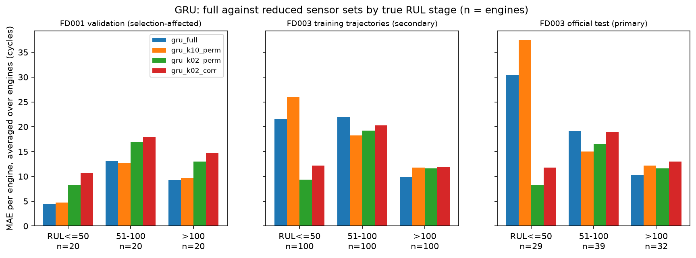

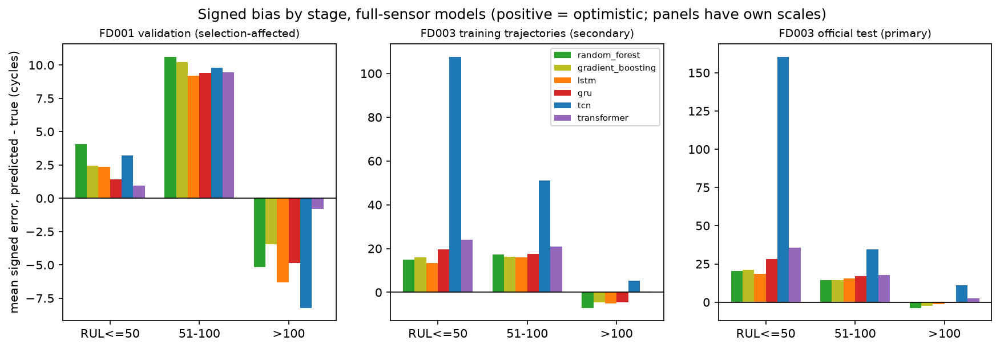

## 7. Worst engines

Predeclared rule: over the six full-sensor models, rank engines by the mean of absolute error, of late error, of early error and of near-failure RMSE (for FD003 test, with one prediction, the absolute error); list the top five. The second view applies the same rule **without the TCN** and was added after the results were seen (*post hoc*).

| dataset | criterion | six models (predeclared) | without TCN (post hoc) |
|---|---|---|---|
| fd001_validation | absolute_error | 57, 28, 93, 100, 98 | 57, 28, 93, 100, 98 |
| fd001_validation | late_error | 57, 28, 93, 98, 60 | 57, 28, 98, 93, 60 |
| fd001_validation | early_error | 22, 5, 100, 26, 52 | 22, 5, 100, 26, 52 |
| fd001_validation | near_failure | 57, 93, 43, 28, 98 | 57, 28, 43, 93, 98 |
| fd003_train | absolute_error | 42, 60, 73, 11, 46 | 42, 73, 60, 11, 89 |
| fd003_train | late_error | 60, 42, 46, 11, 89 | 60, 42, 11, 46, 89 |
| fd003_train | early_error | 4, 8, 15, 86, 6 | 4, 8, 86, 15, 94 |
| fd003_train | near_failure | 42, 89, 11, 60, 73 | 42, 11, 89, 60, 73 |
| fd003_test | absolute_error | 46, 82, 81, 39, 99 | 89, 16, 85, 62, 75 |
| fd003_test | late_error | 46, 82, 81, 39, 99 | 89, 16, 85, 62, 75 |
| fd003_test | early_error | 96, 29, 12, 7, 60 | 96, 29, 7, 12, 80 |
| fd003_test | near_failure | 46, 82, 81, 39, 99 | 89, 75, 81, 46, 72 |

One architecture that fails catastrophically dominates a pooled score. On FD003 test the six-model list (46, 82, 81, 39, 99) and the list without the TCN (89, 16, 85, 62, 75) share no engine, so the first mainly describes where the TCN fails. The TCN failure itself is real and stays in every model comparison.

Do families fail on the same engines? Spearman correlation of per-engine absolute error over the 15 model pairs, and the overlap of each pair's ten worst engines:

| dataset | median_rho | min_rho | max_rho | shared |
|---|---|---|---|---|
| fd001_validation | 0.83 | 0.55 | 0.96 | 7 to 9 |
| fd003_train | 0.81 | 0.57 | 0.96 | 1 to 9 |
| fd003_test | 0.72 | 0.62 | 0.89 | 1 to 8 |

Difficulty is largely shared (positive correlation for every pair), but not identical.

The cycle-wise plots use FD001 validation and FD003 training trajectories. FD003 test gives one prediction per engine, so no trajectory is drawn from it. The plotted engines follow the six-model rule; choosing trajectories by outcome is exploratory. Figure 29 orders engines by the six-model mean, which the TCN weighs heavily.

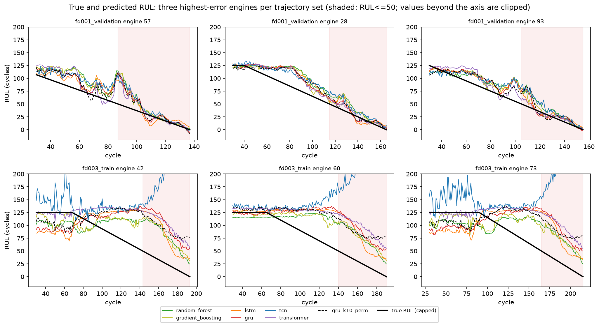

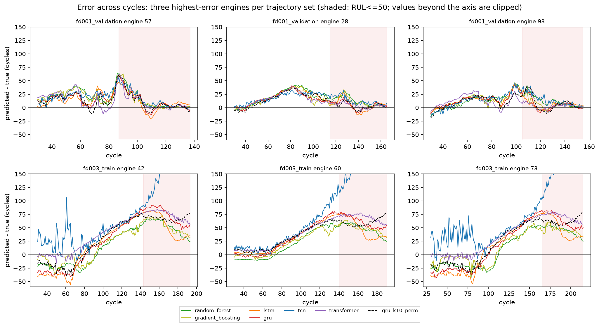

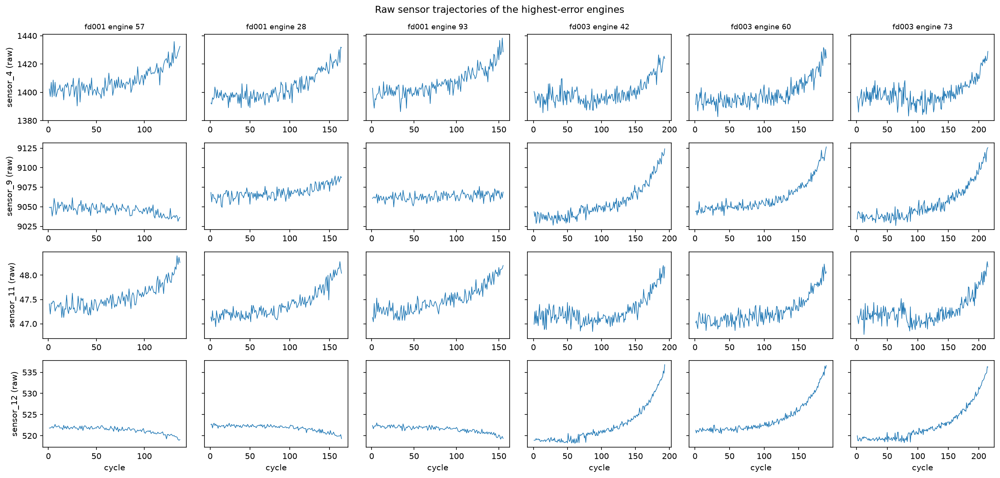

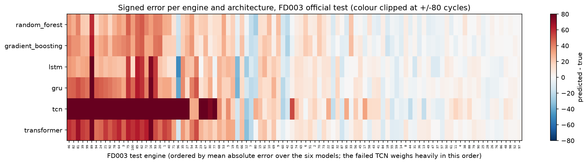

## 8. Late versus early predictions

error = predicted - true. Positive: the model says more life remains than does (optimistic, the dangerous direction for maintenance planning). Negative: it says less (conservative, costs early maintenance). The NASA score uses exp(d/10)-1 for d>=0 and exp(-d/13)-1 for d<0, so an optimistic error costs more.

**Pooled over predictions** (used in figure 28 for all three sets, so that they are comparable; long engines weigh more):

| set | model | mean_signed | median_signed | over_fraction | mean_late_magnitude | mean_early_magnitude | nasa_sum | nasa_late_share |
|---|---|---|---|---|---|---|---|---|
| fd001_validation | random forest | +1.79 | +0.38 | 0.51 | 11.1 | 7.9 | 1.25e+04 | 0.845 |
| fd001_validation | gradient boosting | +1.71 | +0.16 | 0.51 | 10.8 | 7.7 | 1.18e+04 | 0.841 |
| fd001_validation | LSTM | +0.52 | +0.38 | 0.52 | 9.8 | 9.5 | 9.22e+03 | 0.712 |
| fd001_validation | GRU | +0.74 | +0.17 | 0.51 | 9.6 | 8.4 | 9.17e+03 | 0.748 |
| fd001_validation | TCN | +0.28 | +0.03 | 0.50 | 11.4 | 10.9 | 1.22e+04 | 0.720 |
| fd001_validation | Transformer | +1.97 | +0.30 | 0.52 | 9.9 | 6.6 | 1.07e+04 | 0.817 |
| fd003_train | random forest | +2.86 | -1.58 | 0.45 | 18.5 | 9.7 | 2.14e+05 | 0.905 |
| fd003_train | gradient boosting | +4.46 | -0.35 | 0.48 | 17.6 | 7.9 | 2.14e+05 | 0.931 |
| fd003_train | LSTM | +4.21 | +3.28 | 0.62 | 14.6 | 12.7 | 5.7e+05 | 0.951 |
| fd003_train | GRU | +5.84 | +2.13 | 0.57 | 18.6 | 11.4 | 1.04e+06 | 0.978 |
| fd003_train | TCN | +43.35 | +12.62 | 0.75 | 61.4 | 12.3 | 1.49e+17 | 1.000 |
| fd003_train | Transformer | +10.61 | +4.31 | 0.67 | 19.5 | 7.5 | 1.15e+06 | 0.991 |
| fd003_test | random forest | +10.38 | +6.94 | 0.68 | 18.8 | 7.4 | 1.39e+03 | 0.976 |
| fd003_test | gradient boosting | +11.05 | +5.98 | 0.67 | 20.0 | 7.2 | 1.71e+03 | 0.982 |
| fd003_test | LSTM | +11.09 | +6.91 | 0.72 | 19.3 | 10.0 | 6.57e+03 | 0.986 |
| fd003_test | GRU | +14.58 | +8.65 | 0.75 | 22.8 | 10.0 | 1.03e+04 | 0.994 |
| fd003_test | TCN | +63.55 | +15.68 | 0.76 | 87.0 | 10.6 | 2.09e+14 | 1.000 |
| fd003_test | Transformer | +17.99 | +7.15 | 0.75 | 26.6 | 7.8 | 1.13e+04 | 0.997 |
| fd001_validation | gru_k10_perm | +0.03 | -0.68 | 0.47 | 9.9 | 8.7 | 9.56e+03 | 0.737 |
| fd001_validation | gru_k02_perm | +0.15 | -1.23 | 0.46 | 14.2 | 11.9 | 2.47e+04 | 0.806 |
| fd001_validation | gru_k02_corr | +1.44 | +0.14 | 0.51 | 15.8 | 13.3 | 2.55e+04 | 0.776 |
| fd003_train | gru_k10_perm | +4.49 | +1.33 | 0.54 | 19.7 | 13.4 | 1.28e+06 | 0.974 |
| fd003_train | gru_k02_perm | +1.57 | +1.55 | 0.55 | 12.7 | 12.1 | 1.91e+05 | 0.820 |
| fd003_train | gru_k02_corr | +3.53 | +2.50 | 0.58 | 14.4 | 11.3 | 2.25e+05 | 0.881 |
| fd003_test | gru_k10_perm | +13.36 | +4.92 | 0.65 | 26.1 | 10.3 | 1.12e+04 | 0.993 |
| fd003_test | gru_k02_perm | +5.35 | +4.02 | 0.66 | 13.6 | 10.6 | 2.54e+03 | 0.963 |
| fd003_test | gru_k02_corr | +7.13 | +5.04 | 0.65 | 17.0 | 11.2 | 2.72e+03 | 0.971 |

**Per engine, then averaged** (trajectory sets; each engine counts once):

| set | model | engine_mean_signed | engine_mean_over_fraction | engine_mean_late_magnitude | engine_mean_early_magnitude | engine_mean_nasa_late_share |
|---|---|---|---|---|---|---|
| fd001_validation | random forest | +2.84 | 0.55 | 9.9 | 6.7 | 0.669 |
| fd001_validation | gradient boosting | +2.70 | 0.55 | 10.0 | 6.4 | 0.712 |
| fd001_validation | LSTM | +1.49 | 0.55 | 8.8 | 8.7 | 0.605 |
| fd001_validation | GRU | +1.66 | 0.54 | 9.0 | 7.5 | 0.631 |
| fd001_validation | TCN | +1.31 | 0.53 | 10.5 | 9.3 | 0.623 |
| fd001_validation | Transformer | +2.84 | 0.55 | 9.2 | 5.7 | 0.701 |
| fd003_train | random forest | +4.53 | 0.51 | 16.7 | 8.4 | 0.748 |
| fd003_train | gradient boosting | +5.70 | 0.53 | 16.0 | 6.7 | 0.786 |
| fd003_train | LSTM | +5.31 | 0.63 | 13.5 | 8.7 | 0.711 |
| fd003_train | GRU | +6.78 | 0.60 | 16.9 | 8.3 | 0.765 |
| fd003_train | TCN | +36.72 | 0.72 | 42.6 | 6.5 | 0.770 |
| fd003_train | Transformer | +10.55 | 0.66 | 17.1 | 5.1 | 0.812 |

- FD001 validation: close to balanced in count (about half the predictions late), small positive bias.
- FD003 test: all six full models are mainly optimistic, and more than 90% of each pooled NASA score comes from late predictions. Near failure the bias is strongly positive.
- The test NASA sums are concentrated: the five largest engine terms give 57% to 96% of each full model's total (*post hoc*).
- NASA sums grow with the number of predictions and exponentially with large errors; compare them only within one set. The TCN's FD003 values reflect a failure, not a meaningful cost.

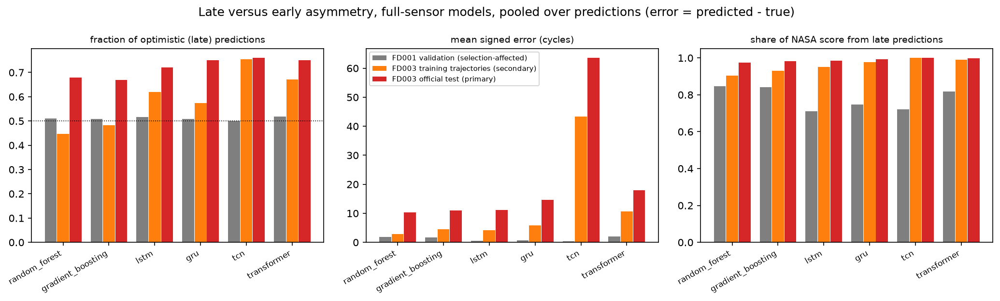

## 9. Sensitivity

### Ranking method

| strategy | FD001 val: below random mean (of 24) | FD003 trajectories | FD003 test | FD003 test without TCN, of 20 (post hoc) | FD003 test: significantly lower | significantly higher |
|---|---|---|---|---|---|---|
| correlation | 2 | 11 | 11 | 10 | 5 | 12 |
| permutation | 24 | 20 | 19 | 15 | 13 | 0 |

The conclusion depends on the ranking method. Permutation subsets beat the random mean on all three sets; its FD001 figure is selection-contaminated, while FD003 labels played no part in choosing it. Correlation subsets are worse than random on FD001 and mixed on FD003. *Exploratory:* the correlation top-10 contains sensors 7, 12, 20 and 21, which shift in FD003; the permutation top-10 omits 7, 20 and 21 but does contain sensor 12.

### RUL cap in training

Seven configurations refitted at caps 100 and 150, plus a control at 125 that reproduced the canonical predictions exactly. Scored on FD001 validation windows with true RUL<=100, where targets are identical.

| candidate | training_cap | common_subset_rmse | common_subset_mae | common_subset_mean_signed | own_cap_rmse | rank_among_full_models |
|---|---|---|---|---|---|---|
| transformer_full | 125 | 13.46 | 9.26 | 5.16 | 12.32 | 3 |
| gru_full | 125 | 12.47 | 8.79 | 5.38 | 12.44 | 1 |
| gb_full | 125 | 13.94 | 9.93 | 6.30 | 12.79 | 5 |
| rf_full | 125 | 13.81 | 9.81 | 7.31 | 12.95 | 4 |
| lstm_full | 125 | 12.89 | 9.41 | 5.74 | 12.99 | 2 |
| tcn_full | 125 | 14.51 | 10.76 | 6.48 | 14.64 | 6 |
| gru_k10_perm | 125 | 12.38 | 8.72 | 5.34 | 12.56 | - |
| transformer_full | 100 | 10.20 | 7.20 | 2.66 | 8.48 | 4 |
| gru_full | 100 | 8.82 | 6.39 | 1.55 | 8.33 | 1 |
| gb_full | 100 | 10.01 | 7.18 | 3.28 | 8.58 | 2 |
| rf_full | 100 | 10.08 | 7.21 | 4.09 | 8.79 | 3 |
| lstm_full | 100 | 10.31 | 7.18 | 3.69 | 9.21 | 6 |
| tcn_full | 100 | 10.27 | 7.45 | 3.13 | 9.58 | 5 |
| gru_k10_perm | 100 | 9.16 | 6.46 | 2.57 | 8.30 | - |
| transformer_full | 150 | 17.20 | 11.36 | 5.39 | 17.15 | 4 |
| gru_full | 150 | 14.41 | 9.90 | 6.34 | 16.40 | 1 |
| gb_full | 150 | 17.13 | 11.72 | 7.83 | 17.18 | 2 |
| rf_full | 150 | 17.24 | 11.76 | 9.53 | 17.45 | 5 |
| lstm_full | 150 | 17.17 | 12.02 | 8.86 | 17.46 | 3 |
| tcn_full | 150 | 18.67 | 13.57 | 9.59 | 19.17 | 6 |
| gru_k10_perm | 150 | 15.72 | 10.75 | 7.12 | 16.76 | - |

Order of the full-sensor models by common-subset RMSE: cap 100: gru, gb, rf, transformer, tcn, lstm; cap 125: gru, lstm, transformer, rf, gb, tcn; cap 150: gru, gb, lstm, transformer, rf, tcn.
The order changes with the cap, so close architecture rankings on FD001 are not robust to it.
Own-cap RMSE values are not comparable across caps. The order also depends on the evaluation subset: at cap 125 the Transformer is first on all validation windows (section 4) but not on windows with RUL<=100. A lower cap reduces error on this subset by construction, so the levels do not show that one cap is better. One seed, FD001 validation only; no cap is recommended or selected, and this does not show robustness in general.

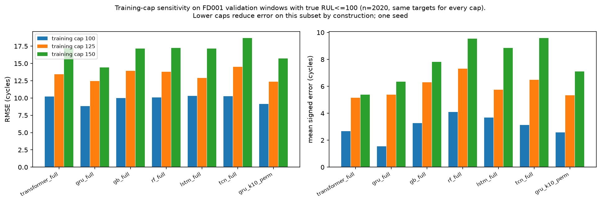

### Evaluation target on FD003 test

Scoring against the uncapped official RUL instead (this changes the question, not the training cap):

| candidate | fd003_test_rmse_capped_target | fd003_test_rmse_uncapped_target | n_engines_above_cap |
|---|---|---|---|
| transformer_full | 30.95 | 31.25 | 15 |
| gru_full | 27.52 | 28.03 | 15 |
| gb_full | 20.98 | 21.92 | 15 |
| rf_full | 20.02 | 21.12 | 15 |
| lstm_full | 23.41 | 24.08 | 15 |
| tcn_full | 116.53 | 116.59 | 15 |
| gru_k10_perm | 29.59 | 30.21 | 15 |
| tcn_k07_perm | 23.02 | 23.69 | 15 |
| gb_k10_random | 21.42 | 22.40 | 15 |
| gru_k02_perm | 18.05 | 19.30 | 15 |
| gru_k02_corr | 19.99 | 21.18 | 15 |

## 10. Statistical evidence

Wilcoxon signed-rank on per-engine absolute error, FD003 test, 100 paired engines, zeros dropped, Holm within family. Difference = first minus second (negative: first is better).

| family | a | b | n_engines | median_difference | ci95_low | ci95_high | rank_biserial | p_value | p_holm | significant_after_correction |
|---|---|---|---|---|---|---|---|---|---|---|
| A_reduced_vs_full | gru_k10_perm | gru_full | 100 | +0.56 | -1.34 | +1.62 | +0.06 | 0.6 | 0.61 | False |
| A_reduced_vs_full | tcn_k07_perm | tcn_full | 100 | -6.58 | -9.05 | -3.32 | -0.70 | 1.5e-09 | 7.5e-09 | True |
| A_reduced_vs_full | gb_k10_random | gb_full | 100 | +0.31 | -0.18 | +1.16 | +0.12 | 0.31 | 0.61 | False |
| A_reduced_vs_full | gru_k02_perm | gru_full | 100 | -2.17 | -4.34 | -0.52 | -0.36 | 0.0018 | 0.0071 | True |
| A_reduced_vs_full | gru_k02_corr | gru_full | 100 | -0.68 | -2.87 | +1.61 | -0.17 | 0.13 | 0.4 | False |
| B_full_vs_reference | gru_full | transformer_full | 100 | -1.66 | -3.14 | -0.16 | -0.31 | 0.007 | 0.007 | True |
| B_full_vs_reference | gb_full | transformer_full | 100 | -2.99 | -5.30 | -1.71 | -0.50 | 1.5e-05 | 4.8e-05 | True |
| B_full_vs_reference | rf_full | transformer_full | 100 | -3.44 | -6.68 | -1.79 | -0.50 | 1.2e-05 | 4.8e-05 | True |
| B_full_vs_reference | lstm_full | transformer_full | 100 | -1.51 | -3.31 | -0.52 | -0.40 | 0.00047 | 0.00094 | True |
| B_full_vs_reference | tcn_full | transformer_full | 100 | +8.40 | +4.86 | +13.24 | +0.70 | 1.4e-09 | 7e-09 | True |

Family C (48 tests, in `artifacts/session8/statistics.csv`): permutation 13 of 24 significantly lower than the random mean and 0 higher; correlation 5 lower and 12 higher.

**Caveats.** The tests concern per-engine absolute error, not RMSE, and the two can disagree. Wilcoxon assumes roughly symmetric paired differences, which these skewed differences only approximate. Holm correction was declared per family. *Post hoc* checks, one Holm correction over all 58 declared tests and an exact sign test:

| a | b | Holm within family | Holm over 58 | sign test |
|---|---|---|---|---|
| gru_k10_perm | gru_full | 0.61 | 1 | 0.48 |
| tcn_k07_perm | tcn_full | 7.5e-09 | 8.4e-08 | 3.2e-05 |
| gb_k10_random | gb_full | 0.61 | 1 | 0.19 |
| gru_k02_perm | gru_full | 0.0071 | 0.041 | 0.0035 |
| gru_k02_corr | gru_full | 0.4 | 1 | 0.76 |
| gru_full | transformer_full | 0.007 | 0.15 | 0.021 |
| gb_full | transformer_full | 4.8e-05 | 0.00045 | 3.2e-05 |
| rf_full | transformer_full | 4.8e-05 | 0.0004 | 0.00041 |
| lstm_full | transformer_full | 0.00094 | 0.013 | 0.00041 |
| tcn_full | transformer_full | 7e-09 | 8e-08 | 3.2e-05 |

The two-sensor permutation GRU result survives the joint correction; the GRU against Transformer difference does not.

These tests describe differences across the 100 FD003 engines for one trained instance of each model. They say nothing about training-seed variation, and comparisons share engines. Non-significance is not equivalence. No test pairs FD001 with FD003 engines. Session 7's FD001 tests are unchanged.

## 11. Efficiency and trade-offs

| candidate | sensors | FD001 val RMSE | FD003 test RMSE | FD003 near-failure MAE | latency ms | windows/s | train s | size bytes | params or nodes |
|---|---|---|---|---|---|---|---|---|---|
| transformer_full | 14 | 12.32 | 30.95 | 37.8 | 8.6 | 29644 | 52.2 | 284038 | 68097 |
| gru_full | 14 | 12.44 | 27.52 | 30.5 | 3.1 | 82842 | 20.1 | 65645 | 15425 |
| gb_full | 14 | 12.79 | 20.98 | 22.6 | 3.5 | 72986 | 0.9 | 875517 | 12196 |
| rf_full | 14 | 12.95 | 20.02 | 21.2 | 4.3 | 59193 | 1.6 | 8505496 | 117656 |
| lstm_full | 14 | 12.99 | 23.41 | 20.8 | 5.0 | 50954 | 13.2 | 63262 | 14625 |
| tcn_full | 14 | 14.64 | 116.53 | 161.5 | 48.5 | 5282 | 152.9 | 101674 | 23617 |
| gru_k10_perm | 10 | 12.56 | 29.59 | 37.4 | 3.1 | 83207 | 19.5 | 62573 | 14657 |
| tcn_k07_perm | 7 | 14.82 | 23.02 | 21.3 | 47.4 | 5406 | 151.1 | 98089 | 22721 |
| gb_k10_random | 10 | 13.40 | 21.42 | 23.4 | 6.5 | 39858 | 1.4 | 831067 | 12200 |
| gru_k02_perm | 2 | 17.32 | 18.05 | 8.3 | 3.1 | 83802 | 12.7 | 56428 | 13121 |
| gru_k02_corr | 2 | 18.95 | 19.99 | 11.8 | 3.1 | 83726 | 10.0 | 56427 | 13121 |

Latency and throughput are the single Session 7 measurements (see `session7_followup/power_latency_provenance.md`); nothing was re-timed. They separate families only coarsely and support no sensor-level speed claim, whatever numerical Pareto membership says. Parameter counts and tree nodes are not the same kind of complexity.

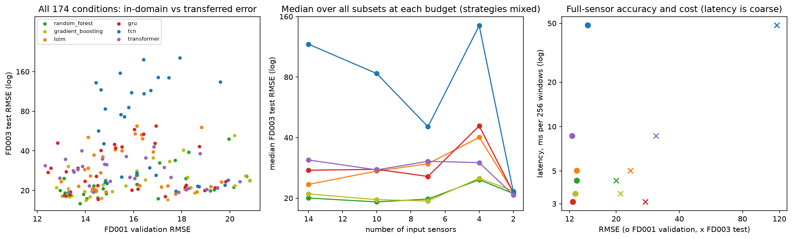

## 12. Conclusions

### The ten questions

1. **Best architecture with 14 sensors.** It depends on the protocol. On FD001 validation the Transformer (12.32; descriptive, selection-affected). On the terminal test sets random forest is first on both FD001 (already inspected, 11.59) and FD003 (20.02). On FD003 test the Transformer's absolute errors are significantly larger than those of GRU, gradient boosting, random forest and LSTM (family B, these trained instances).
2. **Accuracy against inference cost.** On FD001, GRU: 12.44 at 3.1 ms against 12.32 at 8.6 ms. If transfer matters, gradient boosting is more defensible: 12.79 on FD001, 20.98 on FD003, 3.5 ms (*post hoc* recommendation, made after seeing FD003; these test results cannot also confirm it).
3. **Smallest budget within 5% on FD001.** Seven sensors, only for the TCN with permutation ranking (selection-contaminated, and the TCN's absolute error is the highest). Ten sensors for random forest, gradient boosting, GRU with permutation ranking. Without ranking, the mean of random draws stays within 5% at ten sensors for random forest, gradient boosting, TCN. No correlation subset does.
4. **Least sensitive to reduction.** TCN on FD001 (mean increase over ranked subsets +13.9%), a relative measure on the weakest full model; the same architecture fails on FD003. Relative robustness to sensor removal says nothing about robustness to domain shift.
5. **Does ranking beat random?** Not in general. Permutation: yes on all three sets (24/24 contaminated on FD001, 19/24 on FD003 test). Correlation: no (2/24 on FD001, 11/24 on FD003 test).
6. **Does the preferred reduced set (GRU, 10, permutation) generalise?** Not well. Its FD003 test RMSE is 29.59 (12.56 on FD001 validation, a different protocol). It is not distinguishable from the full GRU (27.52; adjusted p = 0.61), which also fails to transfer well, and its near-failure MAE is higher (37.4 against 30.5).
7. **Largest weaknesses.** On FD003 test, near failure (all six full models strongly optimistic). On FD003 training trajectories the largest errors of random forest, gradient boosting, LSTM and GRU are instead in the intermediate stage. Hardest FD003 test engines: 89, 16, 85, 62, 75 without the TCN (post hoc), 46, 82, 81, 39, 99 with it.
8. **Optimistic or conservative?** Nearly balanced on FD001 validation; mainly optimistic on FD003 test for every full model.
9. **What is statistically supported?** Only these FD003 test differences in per-engine absolute error, for these trained instances on this dataset: family B (all five against the Transformer, four lower and the TCN higher); family A for the two-sensor permutation GRU and the seven-sensor TCN against their full models; and in family C 13 permutation and 5 correlation comparisons lower, 12 correlation higher. The ten-sensor GRU, the gradient boosting random draws and the two-sensor correlation GRU are **not** shown to differ from their full models, which is not equivalence. Session 7's FD001 reduced-against-full tests are selection-affected. FD001 architecture ranking is descriptive.
10. **When do the conclusions stop holding?** Under the FD003 shift; for the TCN on FD003; possibly under other seeds or caps; and for any real engine.

### Defensible conclusions

1. Every full-sensor model has clearly larger errors on FD003 test than on the matched FD001 terminal test. The FD001 *validation* order did not carry over to FD003 test (Spearman 0.03), but it did not carry over to FD001 test either (0.31), while the two terminal tests order the models similarly (0.83). A change of architecture order caused by domain shift is therefore not established.
2. Fewer sensors can transfer better, but not reliably. The GRU with two permutation-ranked sensors beats the full GRU on FD003 test (18.05 against 27.52; adjusted p = 0.007), although the same reduction was clearly harmful on FD001. The two-sensor correlation set (adjusted p = 0.40) and ten sensors (GRU and gradient boosting) show no significant difference, and the seven-sensor TCN's advantage only reflects the failure of the full TCN. The two-sensor gain is concentrated near failure (MAE 8.3 against 30.5); in early life it is slightly worse (11.6 against 10.2). The lowest FD003 test RMSE among all 174 conditions is 15.93 (random forest, k=7, random); picking it would be selection on the test set, so it is descriptive only.
3. On FD003 test the full-sensor models' errors are predominantly optimistic and, in that terminal sample, largest near failure. The FD003 training trajectories show the optimistic bias less uniformly and do not show near failure as the worst stage for most models.
4. Permutation-ranked subsets did better than random controls on FD003 as well, but this does not establish a general ranking advantage: correlation ranking did not, and the mechanism is untested.

### Evidence classes

| Class | Content |
|---|---|
| Preselected FD003 evaluation (primary; per local records) | Candidate metrics, families A and B |
| Secondary, planned | Family C, all 174 conditions, trajectory analyses, cap study |
| FD001 validation observations | Sections 4, FD001 rows elsewhere (selection-affected) |
| Selection-contaminated | Every permutation result on FD001 validation |
| Post hoc / exploratory | All narrative and figures; architecture-order analysis; views without the TCN; ratios without the TCN; sensor-exposure and shift remarks; joint correction, sign tests, NASA concentration; preferring gradient boosting after FD003 |

## 13. Limitations and threats to validity

1. **Simulated data**, two related subsets. Removing a model input does not show that a physical sensor can safely be removed from an aircraft.
2. **One training seed.** Differences of a few cycles may be training randomness; engine-level tests do not cover it.
3. **Selection on FD001 validation** (architectures, hyperparameters, early stopping, permutation ranking, candidate choice).
4. **Scaling is part of the transferred model.** Another normalisation or domain adaptation might change every FD003 result; none was tried, by design.
5. **Different protocols**: FD001 validation windows, FD003 trajectories and FD003 terminal windows differ in engine count, lifetime and stage mix.
6. **No per-engine fault labels**, so errors cannot be split by fault mode.
7. **Candidates were chosen with all FD001 results known**, including the earlier official-test rows.
8. **Latency** is a single, coarse measurement on one laptop.
9. The cap study covers one dataset, one seed and two alternative caps.
10. **Chronology is self-attested.** The access log, hashes and file times were produced by the same workflow; nothing was externally time-stamped or committed. The first draft of the protocol (before the cap-125 control was added) was not preserved, and unlogged reads cannot be excluded by these records.
11. The protocol says the test set is evaluated once; the log shows two label reads. The second rebuilt the tables from the same cached predictions to check determinism; it did not run inference again and the master table did not change.
12. Multiple-testing correction is per declared family.
13. The TCN failure dominates any score averaged over all six architectures.
14. FD003 test has now been seen and cannot serve as untouched data.

## 14. Reproducibility

See [session8_reproducibility.md](session8_reproducibility.md). Tables are in `artifacts/session8/`; predictions and fits in `results/session8/` (git-ignored).

## 15. Recommended future work

- Repeat training over several seeds before ranking architectures.
- Select sensors inside engine-level cross-validation, then test once.
- Study normalisation and domain adaptation with a new, untouched evaluation set; FD003 test is now seen.
- Test FD002 and FD004 (varying operating conditions).
- Check whether penalising optimistic errors reduces near-failure bias.
- Time inference repeatedly on controlled hardware.
